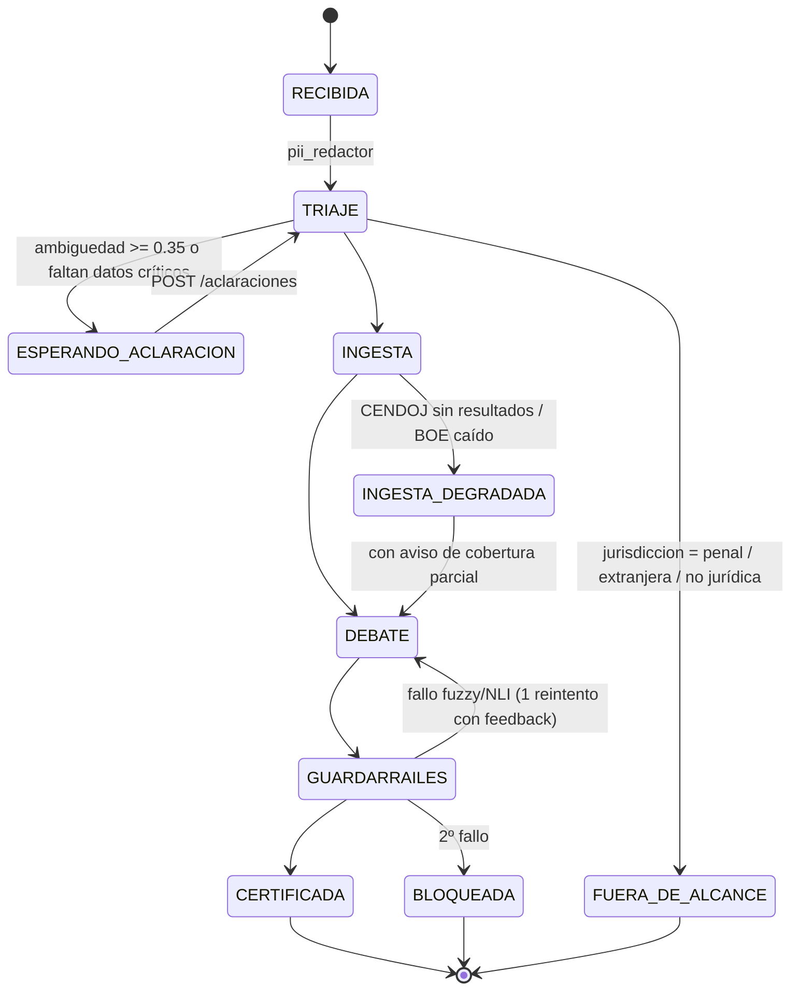
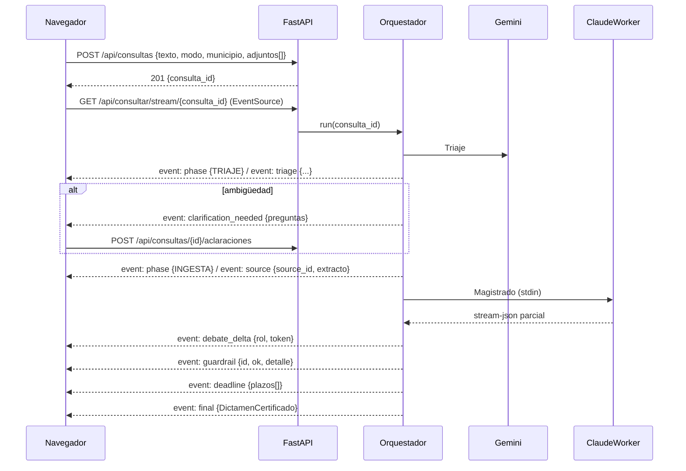

# IURIS-IA / LEX-AGENT ES — Dossier de Planificación Integral (v3.0, modo plan)

> **Entrega:** este documento es el dossier pedido. Al aprobar el plan, la única acción será copiarlo a
> `docs/IURIS_IA_Dossier_Planificacion_v3.md` en el workspace (sin generar código de aplicación).
> Base de partida: `Propuesta_Maestra_IurisIA_LexAgent_Definitiva.pdf` (v2.1). Donde este dossier **corrige** la v2.1, se marca con **⚠ CORRECCIÓN v2.1**.

## Contexto

La v2.1 describe bien la visión (RAG quirúrgico + guardarraíles deterministas + debate contradictorio), pero deja sin especificar los contratos de datos, la máquina de estados, la UI y los criterios de aceptación, y contiene varias afirmaciones técnicas y jurídicas que, implementadas tal cual, producirían fallos (argv demasiado largo en Windows, postulación mal definida en lo social, scraping con evasión anti-bot, datos personales enviados a un tier gratuito que entrena con ellos). Este dossier deja el sistema especificado para que un ingeniero sin formación jurídica pueda programarlo por sprints con pruebas objetivas.

**Convención de rigor:** toda regla jurídica de este dossier es *especificación a validar por un profesional del derecho antes del Sprint 3*; se marcan con 🔎 las que tienen criterio jurisprudencial cambiante. Los nombres de modelos (Gemini 3.8 Flash, Gemini 4 Argon, Opus 5.5…) se tratan siempre como **IDs configurables** en `config/models.toml`, nunca *hardcoded*.

---

# BLOQUE 1 — Viabilidad y matriz de riesgos residuales

## 1.1 Viabilidad técnica y de cuotas

### Veredicto: VIABLE con 4 condiciones

| # | Condición | Motivo |
|---|---|---|
| C1 | **Toda ingesta masiva va por Gemini API (AI Studio)**, nunca por Claude | La ventana de 5 h y el límite semanal de Claude Pro son compartidos con tu uso interactivo de Claude Code/claude.ai. |
| C2 | **Los documentos personales del usuario NO van al Free Tier de Gemini** sin seudonimizar | ⚠ CORRECCIÓN v2.1: en el tier gratuito de la Gemini API Google puede usar el contenido para mejorar productos y puede haber revisión humana. Nóminas, cartas de despido o DNI son datos personales (RGPD). Ver §1.1.4. |
| C3 | **Prompt por stdin, no por argv**, en `claude -p` | ⚠ CORRECCIÓN v2.1: el código de §11.1 pasa el prompt como argumento. En Windows `CreateProcess` limita la línea de comandos a 32.767 caracteres; un dossier de 3.000 tokens + system prompt + historial lo supera → fallo silencioso o truncado. |
| C4 | **Google AI Pro / Antigravity no es una API** | ⚠ CORRECCIÓN v2.1: la suscripción Google AI Pro y el IDE Antigravity no exponen cuota consumible desde tu backend. Lo único invocable desde Python es la **Gemini API** (AI Studio, con su propia clave y límites). "Gemini 4 Argon" solo se usa si aparece en la Gemini API; si no, el modo que lo usa degrada a Opus. |

### 1.1.1 Presupuesto de llamadas por consulta y por modo

Fase 3 son **tres roles** (Defensa, Contraparte, Magistrado). En la v2.1 el modo Pro haría 3 llamadas Opus por consulta; es el principal consumidor de cuota. Asignación propuesta:

| Modo | F1 Triaje | F2 Cribado | F3 Defensa | F3 Contraparte | F3 Magistrado | F4 NLI | Llamadas Claude / consulta |
|---|---|---|---|---|---|---|---|
| **Eco** | Gemini Flash (low) | Gemini Flash (low) | Gemini Flash (med) | Gemini Flash (med) | Gemini Flash (high) | Gemini Flash (low) | **0** |
| **Equilibrado** | Gemini Flash (low) | Gemini Flash (low) | Gemini Flash (med) | Gemini Flash (med) | **Claude Sonnet** (med) | Gemini Flash (low) | **1** |
| **Pro** | Gemini Flash (low) | Gemini Flash (med) | **Claude Sonnet** (med) | **Claude Sonnet** (med) | **Claude Opus** (high) | Gemini Flash (low) | **3** (1 Opus) |
| **Auditoría cruzada** (opcional) | = Pro | = Pro | = Pro | = Pro | Claude Opus + auditor Gemini top-tier | Gemini | 3 |

Principio de **verificación cruzada de familia**: el NLI de Fase 4 lo ejecuta siempre una familia distinta a la que redactó el dictamen (si el Magistrado es Gemini, el NLI usa Claude Haiku; si es Claude, usa Gemini).

> Las cifras de la v2.1 (“~3 % / ~9 % de cuota”) **no son verificables**: Anthropic no publica la cuota en tokens. Se sustituyen por medición real: `QuotaLedger` (tabla `llm_calls_ledger`) registra `usage` y `total_cost_usd` (coste *equivalente*, no cobrado) que devuelve `claude -p --output-format json/stream-json`. Tras 2 semanas de uso se calibra un presupuesto empírico.

### 1.1.2 Circuit breaker de cuota (degradación automática)

```
Claude devuelve rate-limit / "usage limit reached"  ─►  breaker OPEN (hasta reset_at informado o +60 min)
     │                                                        │
     ▼                                                        ▼
UI: banner "Cuota Claude agotada hasta HH:MM"        Router re-mapea roles Claude → Gemini (mismo prompt, mismo schema)
```

- Estados: `CLOSED → OPEN → HALF_OPEN` (1 llamada de sonda). Persistido en SQLite para sobrevivir reinicios.
- Gemini Free Tier tiene límites RPM/RPD por modelo (consultar la tabla vigente en AI Studio; cambian). `GeminiRateLimiter` = token bucket por modelo con valores en `config/models.toml`; HTTP 429 → *backoff* exponencial con *jitter* (máx. 3 reintentos) y luego degradación a otro modelo Flash configurado.

### 1.1.3 Cola serializada de Claude en Windows

Problemas a evitar: dos `claude` concurrentes escribiendo en `~/.claude` (sesiones/estado), bloqueos de fichero en NTFS, y `asyncio.create_subprocess_exec` que **no funciona con `SelectorEventLoop`** (uvicorn con `--reload` en Windows puede forzarlo).

Diseño `ClaudeWorker`:
1. **Un único hilo trabajador** (`threading.Thread`) con `queue.Queue` de trabajos; el backend asyncio encola y recibe tokens por un `asyncio.Queue` vía `loop.call_soon_threadsafe`. Independiente del tipo de event loop.
2. **Lock inter-proceso** `filelock.FileLock(%LOCALAPPDATA%/iuris/claude.lock)` por si se lanzan dos instancias del backend o el benchmark en paralelo.
3. Invocación con `subprocess.Popen([CLAUDE_EXE, "-p", "--model", m, "--output-format", "stream-json", "--verbose", ...], stdin=PIPE, stdout=PIPE)`; el prompt completo se escribe en **stdin** codificado UTF-8. `CLAUDE_EXE = shutil.which("claude")` (en Windows suele ser un `.cmd`; resolver ruta absoluta).
4. `cwd` = directorio vacío dedicado (`%LOCALAPPDATA%/iuris/claude_sandbox`) para que el CLI no cargue `CLAUDE.md` ni herramientas del proyecto; herramientas deshabilitadas y 1 turno. **Spike Sprint 1:** confirmar con `claude --help` los flags exactos de la versión instalada (`--system-prompt`/`--append-system-prompt`, `--max-turns`, deshabilitar tools, `--include-partial-messages` para streaming token a token, y cómo fijar el *effort*; si no existe flag de effort, se fija por settings/variable de entorno o se omite).
5. *Timeout* duro por llamada (Sonnet 120 s, Opus 300 s) → `proc.kill()` + error tipado `ClaudeTimeout`.
6. Parser de `stream-json` línea a línea: eventos de texto parcial → `token`; evento `result` → `usage`, `total_cost_usd`, `is_error`.

### 1.1.4 Política de privacidad de datos (decisión de diseño obligatoria)

| Tipo de dato | Puede ir a Gemini Free Tier | Puede ir a Claude Pro | Tratamiento previo |
|---|---|---|---|
| BOE, sentencias CENDOJ (ya anonimizadas por el CGPJ), convenios | Sí | Sí | — |
| Texto libre de la consulta | Solo seudonimizado | Sí | `pii_redactor.py` (regex DNI/NIE/IBAN/teléfono/email/matrícula + nombres propios detectados) → tokens `[[PERSONA_1]]` reversibles en local |
| PDFs adjuntos (nómina, contrato, carta) | **No** por defecto | Sí | Extracción de texto **local** (pdfplumber/OCR) + seudonimización; el usuario puede activar "permitir Gemini" por documento |

Recomendación adicional: en Claude, desactivar en la configuración de privacidad de la cuenta el uso de chats para entrenamiento. Alternativa a futuro: clave Gemini de pago (tier de pago no usa datos para entrenar) — rompe el "coste 0 €", se deja como interruptor.

## 1.2 Viabilidad del acceso a datos

### 1.2.1 BOE — VIABLE, riesgo bajo
API pública de Datos Abiertos (`/datosabiertos/api/legislacion-consolidada`): búsqueda, `/id/{id}/metadatos`, `/id/{id}/analisis`, `/id/{id}/texto/indice`, `/id/{id}/texto/bloque/{id_bloque}`. Puntos clave:
- **Versionado por bloque:** cada bloque trae sus **versiones** con fecha de publicación/vigencia. ⚠ CORRECCIÓN v2.1: la ley aplicable es la **vigente en la fecha de los hechos**, no la de hoy. `temporal_sync.py` debe seleccionar la versión por `fecha_hechos` (dato que el triaje debe preguntar) y avisar si la versión actual difiere.
- El texto suele servirse en **XML**; el parser debe soportar XML (lxml) y JSON donde exista, y la polimorfía `str | list[str]` en párrafos.
- La BOE consolida también legislación autonómica (necesario para derecho foral).
- Caché con *ETag/fecha_actualizacion*; refresco semanal de las ~40 normas núcleo.

### 1.2.2 CENDOJ — VIABLE como **Cache-First curado**, riesgo medio-alto en el *fallback*
- ⚠ CORRECCIÓN v2.1: **se elimina `playwright-stealth`**. Diseñar un componente cuyo fin es evadir la detección anti-bot de un portal público expone a bloqueo de IP y choca con las condiciones de reutilización del CGPJ (prohíben descargas masivas automatizadas sin autorización). Sustituto: `cendoj_fetcher.py` **identificado y cortés** (User-Agent real, 1 petición / 10 s, máx. 200/día, respeto de errores) para búsquedas puntuales, + **importación manual** (el usuario pega un ROJ/ECLI o arrastra el PDF de la sentencia).
- Corpus de 5.000 resoluciones: construcción incremental durante semanas (a 200/día ≈ 25 días) priorizando por submateria del glosario (Bloque 4). Si se obtiene autorización/convenio de reutilización del CENDOJ, se acelera.
- Latencia <50 ms: alcanzable. 5.000 sentencias × ~20 *chunks* ≈ 100.000 vectores; LanceDB con índice IVF_PQ + *prefiltro* por jurisdicción da latencias de decenas de ms en CPU. Se complementa con **SQLite FTS5 (BM25)** para búsqueda léxica (ROJ, artículos citados, términos exactos) → *hybrid retrieval* con *Reciprocal Rank Fusion*.
- ⚠ CORRECCIÓN v2.1: **SQLite-VSS está abandonado** (sustituido por sqlite-vec). Se usa solo LanceDB + FTS5.
- **Embeddings:** Gemini Embedding API (free tier) con `output_dimensionality=768`; el modelo y dimensión quedan registrados por fila para permitir re-indexar. (Un modelo de embeddings CPU local sería un plan B, pero contradice la restricción "sin modelos locales"; no se incluye.)

### 1.2.3 Convenios colectivos — VIABLE, riesgo medio (mantenimiento)
- Selección de los 30: criterio objetivo = **nº de trabajadores afectados** según la Estadística de Convenios Colectivos del Ministerio de Trabajo/REGCON, restringido a los sectores pedidos. Lista candidata inicial (a confirmar con datos): estatales — Construcción (Convenio General), Metal (CEM), Contact center, Seguridad privada, Grandes almacenes, Dependencia, Limpieza de edificios (marco), Hostelería (ALEH), Industria química, Enseñanza privada concertada; provinciales — Hostelería (Madrid, Barcelona, Baleares, Málaga, Valencia, Alicante, Las Palmas, S. C. Tenerife), Comercio (Madrid, Barcelona, Valencia, Sevilla), Oficinas y despachos (Madrid, Barcelona, Valencia), Metal (Madrid, Barcelona, Valencia, Bizkaia), Limpieza (Madrid, Barcelona).
- **Concurrencia de convenios** (estatal vs provincial, Art. 84 ET): el sistema muestra ambos y marca "posible concurrencia, verificar" en vez de elegir uno.
- **Versionado obligatorio:** las tablas salariales se revisan cada año; ⚠ CORRECCIÓN v2.1: `convenios_cache` sin vigencia es insuficiente → ver DDL (convenio + versión + tablas).
- Protocolo de ingesta: descarga del PDF del BOE/BOP → `pdf_extractor` → segmentación por artículos (regex `^Artículo\s+\d+`) → extracción de tablas salariales con Gemini (structured output → `TablaSalarial`) → **verificación determinista**: cada importe extraído debe aparecer literalmente en el texto (fuzzy ≥95 % sobre la fila). 
- Selector UI: si el usuario sube nómina, `nomina_parser` extrae CNAE/convenio citado/categoría (los recibos suelen indicarlo) y propone el convenio; si no hay match en los 30, ofrece cargar el PDF del convenio de empresa (se indexa solo para esa sesión o permanentemente, a elección).

## 1.3 Viabilidad procesal y deontológica

### 1.3.1 Intrusismo (Art. 403 CP) y AI Act
- Uso **personal y local** por el propio usuario: el Art. 403 CP sanciona ejercer actos propios de una profesión sin título; una herramienta de autoinformación no lo es. El riesgo aparece si se ofrece a terceros → **regla de producto:** la app es monousuario, no expone puertos fuera de `127.0.0.1` y la licencia/README lo declara.
- AI Act Art. 2.10: excluye a personas físicas en actividad puramente personal no profesional. Se mantiene el encuadre; si algún día se distribuye, el análisis cambia (posible alto riesgo, Anexo III punto 8 — administración de justicia — a evaluar).
- **Prohibido** cualquier número de probabilidad. Escala cualitativa cerrada (enum) en `DictamenCertificadoSchema.banda_solidez`:

| Banda (enum) | Texto UI | Condición mínima (validada en Fase 4) |
|---|---|---|
| `CRITERIO_CONSOLIDADO_FAVORABLE` | Criterio consolidado favorable | ≥1 STS o ≥2 SAP concordantes citadas y verificadas; sin contradicción NLI |
| `ARGUMENTO_SOLIDO_SIN_DOCTRINA` | Argumento sólido, sin doctrina consolidada | Norma clara verificada, sin jurisprudencia citada |
| `DISPARIDAD_DE_CRITERIO` | Disparidad de criterio entre tribunales | Sentencias citadas en ambos sentidos, o tema 🔎 |
| `RIESGO_PROBATORIO_ALTO` | Depende de pruebas que quizá no tengas | `hechos_a_probar` sin documento aportado |
| `CRITERIO_CONSOLIDADO_DESFAVORABLE` | Criterio consolidado desfavorable | simétrico al primero |
| `NO_DETERMINABLE` | No es posible valorar | Falta información o fallan guardarraíles |

Un validador de salida rechaza (y reintenta 1 vez, luego bloquea) cualquier dictamen cuyo texto contenga `\d+\s*%` junto a palabras de éxito/probabilidad/ganar.

### 1.3.2 Postulación — ⚠ CORRECCIÓN v2.1 importante
La v2.1 dice que la demanda de despido exige Abogado y Procurador. **Es incorrecto**: en el orden social en la instancia la parte puede comparecer por sí misma (LRJS arts. 18 y 21); el abogado es preceptivo en el recurso de suplicación/casación. Tabla determinista (`postulacion_rules.py`), a validar por jurista:

| Orden / procedimiento | Abogado | Procurador | Acción del sistema |
|---|---|---|---|
| Civil, juicio verbal ≤ 2.000 € (Arts. 23.2.1º y 31.2.1º LEC) | No | No | Permite orientar sobre escritos |
| Civil, petición inicial de monitorio (cualquier cuantía) (Art. 814.2 LEC) | No | No | Permite; avisa: si hay oposición > 2.000 € se requerirán ambos |
| Civil > 2.000 € (verbal o ordinario) | **Sí** | **Sí** | **Bloquea redacción de escritos**; banner no saltable |
| Social, instancia (despido, cantidad, sanción) | No (recomendable) | No | Permite; recomienda graduado social/abogado/sindicato; advierte de conciliación previa obligatoria (SMAC) |
| Social, recurso de suplicación | **Sí** (o graduado social) | No | Bloquea escritos |
| Administrativo, vía administrativa (alegaciones, reposición, alzada) | No | No | Permite |
| Contencioso-administrativo | **Sí** con carácter general (Art. 23 LJCA; excepción funcionarios en cuestiones de personal) | Según órgano | Bloquea escritos salvo excepción |
| Penal | Según procedimiento | — | Fuera de alcance v1: solo informa y deriva |

"Bloquear" = la app sigue informando y calculando plazos, pero no genera borradores de escritos procesales. Para el usuario sin recursos se muestra siempre: **asistencia jurídica gratuita** (Ley 1/1996) y el Colegio de Abogados del partido judicial.

### 1.3.3 Motor de calendario — VIABLE, riesgo alto en el dato local
- España tiene **8.131/8.132 municipios** (según el padrón del año). **No existe un dataset oficial único de festivos locales**: los publica cada comunidad/provincia en boletines distintos y formatos dispares. Coste de construirlo completo: alto y anual.
- Estrategia por capas: (1) festivos **nacionales y autonómicos** — resolución anual de la Dirección General de Trabajo en el BOE (cobertura 100 %, 1 fuente); (2) **locales** de las ~60 capitales y municipios con sede de partido judicial relevantes, cargados al inicio; (3) resto **bajo demanda**: el usuario indica municipio; si no está, la app pide confirmar los 2 festivos locales (con enlace al boletín) y los guarda con `fuente='usuario'`. Los plazos calculados con un festivo no verificado muestran el aviso "festivo local no verificado".
- ⚠ Importante: para plazos procesales cuenta el calendario de la **sede del órgano judicial** (o de la Administración, en vía administrativa), no el domicilio del usuario.
- **Día de Gracia (Art. 135.5 LEC)**: solo para **presentación de escritos ante tribunales** con vencimiento procesal. **No aplica** a plazos administrativos (Ley 39/2015) ni debe usarse como plazo "real" para plazos de caducidad sustantiva 🔎 (p. ej. papeleta de conciliación por despido). Regla de producto: la línea temporal muestra siempre la **fecha límite segura = último día hábil** en rojo, y el día de gracia (hasta 15:00) en gris como información, nunca como recomendación.

## 1.4 Matriz de riesgos residuales

Escala P (probabilidad) e I (impacto): 1–5. Riesgo = P×I.

| ID | Riesgo | P | I | R | Mitigación | Residual |
|---|---|---|---|---|---|---|
| R1 | Cálculo erróneo de un plazo preclusivo → pérdida de una acción | 3 | 5 | 15 | Motor determinista + 60 casos de test validados por jurista + "fecha segura" con margen + aviso de festivo no verificado | Medio |
| R2 | Cita inventada o artículo mal numerado | 4 | 4 | 16 | Fuzzy ≥95 % contra `source_id` declarado + rechazo de citas sin fuente en el dossier | Bajo |
| R3 | Conclusión que contradice la norma citada | 3 | 4 | 12 | NLI cruzado de familia; CONTRADICTS bloquea | Medio |
| R4 | Ley aplicada en versión no vigente a la fecha de los hechos | 3 | 4 | 12 | Selección de versión por `fecha_hechos` | Bajo |
| R5 | Datos personales en Free Tier de Gemini | 4 | 4 | 16 | Política §1.1.4 + `pii_redactor` + test que falla si un DNI sale hacia Gemini | Bajo |
| R6 | Agotamiento de cuota Claude a mitad de consulta | 4 | 2 | 8 | Circuit breaker + degradación | Bajo |
| R7 | Cambios en flags del CLI `claude` tras una actualización | 3 | 3 | 9 | Test de contrato del CLI al arrancar (`claude --version` + llamada sonda) | Bajo |
| R8 | Modelos "Gemini 3.8 Flash"/"Argon" renombrados o retirados del free tier | 3 | 3 | 9 | IDs en config + lista de *fallback* | Bajo |
| R9 | Bloqueo o reclamación del CGPJ por scraping | 2 | 3 | 6 | Sin stealth; cortesía; importación manual | Bajo |
| R10 | Convenio desactualizado (tablas salariales) | 4 | 3 | 12 | Versionado + aviso de "vigencia hasta" + revisión trimestral | Medio |
| R11 | Doctrina cambiante (p. ej. despido en IT) presentada como firme | 3 | 4 | 12 | Marca 🔎 en glosario → banda `DISPARIDAD_DE_CRITERIO` forzada | Medio |
| R12 | El usuario trata el dictamen como asesoramiento profesional | 4 | 4 | 16 | Avisos permanentes, bloqueo de escritos, derivación a abogado/AJG | Medio (inherente) |
| R13 | Benchmark con 25 casos sin significación estadística | 5 | 2 | 10 | Tratarlo como *smoke test*; ampliar a 100 casos en v2 | Medio |
| R14 | Contaminación de memoria del modelo con sentencias famosas | 4 | 2 | 8 | Permutaciones sintéticas + casos de AP poco conocidos | Medio |

---

# BLOQUE 2 — Arquitectura de software y flujo de datos

## 2.1 Diagrama de componentes

```mermaid
flowchart LR
  subgraph UI["Frontend (React + Vite + Tailwind, PWA) — localhost:8000"]
    CHAT[Chat SSE] --- DEBATE[Pestañas Defensa / Contraparte / Magistrado]
    CHAT --- VISOR[Visor lateral BOE · CENDOJ · Convenio]
    CHAT --- TIMELINE[Línea temporal de plazos]
    CHAT --- DROP[Drag & drop adjuntos]
    MODE[Selector Eco / Equilibrado / Pro]
  end

  subgraph API["Backend FastAPI (127.0.0.1)"]
    REST[/REST: consultas, adjuntos, fuentes, calendario/]
    SSE[/SSE: /api/consultar/stream/{id}/]
    ORCH[orchestrator.py — máquina de estados]
  end

  subgraph CORE["core/"]
    ROUTER[router.py — ModelRouter]
    GW[gemini_client.py + RateLimiter]
    CW[claude_worker.py — cola serializada + FileLock]
    CB[circuit_breaker.py + QuotaLedger]
    VAL[validators.py — fuzzy, NLI, anti-%]
    CAL[calendar_engine.py]
    POST[postulacion_rules.py]
    TEMP[temporal_sync.py]
    PII[pii_redactor.py]
  end

  subgraph DATA["connectors/ + storage/"]
    BOE[boe_client.py] --> SQL[(SQLite WAL + FTS5)]
    CEN[cendoj_fetcher.py] --> SQL
    CEN --> LDB[(LanceDB)]
    CONV[convenios_db.py] --> SQL
    PDF[pdf_extractor.py + OCR]
    RET[retriever.py — híbrido BM25+vector+RRF]
  end

  UI <--> REST
  UI <-- eventos --> SSE
  SSE --- ORCH
  ORCH --> ROUTER --> GW & CW
  ROUTER --- CB
  ORCH --> RET --> SQL & LDB
  ORCH --> VAL & CAL & POST & TEMP & PII
  GW -->|HTTPS| GEM[(Gemini API)]
  CW -->|stdin/stdout| CLI[[claude -p]]
  BOE -->|HTTPS| BOEAPI[(BOE Datos Abiertos)]
```

## 2.2 Máquina de estados de una consulta



## 2.3 Las 4 fases en detalle

### Fase 1 — Triaje multihop
- **Entrada:** consulta seudonimizada + metadatos de adjuntos + municipio (si lo hay).
- **Proceso:** Gemini Flash (low) con *structured output* = `TriageOutputSchema`. Hop 1: clasificar jurisdicción y submateria contra el **catálogo cerrado** del Bloque 4 (enum, no texto libre). Hop 2: por cada rama candidata, lista de normas BOE objetivo desde `catalogo_normas.json` (no las inventa el modelo: elige IDs de un catálogo) y términos de búsqueda CENDOJ. Hop 3: detectar datos críticos faltantes por submateria (`campos_criticos` del catálogo: p. ej. despido → fecha de notificación, tipo de contrato, ¿baja médica?).
- **Ambigüedad estructural** (ej. falso autónomo): si dos ramas tienen probabilidad > 0,25 y llevan a jurisdicciones u órdenes distintos, se fuerzan preguntas aclaratorias. Las "probabilidades" de rama son **internas de enrutamiento**, nunca se muestran como pronóstico.
- **Alertas de prescripción/caducidad**: el triaje solo identifica `tipo_plazo` y `fecha_inicio_computo`; el **cálculo** lo hace siempre `calendar_engine` (el LLM nunca calcula fechas).

### Fase 2 — Ingesta quirúrgica
1. BOE: para cada `id_norma` + `articulos_objetivo` → caché SQLite → si no o caducado, API BOE → versión vigente a `fecha_hechos`.
2. Jurisprudencia: `retriever.hybrid(query, filtros={jurisdiccion, submateria, tribunal_min})` → top-20 chunks → *rerank* con Gemini Flash (listwise, devuelve IDs) → top-5 sentencias. Solo `fundamentos_mayoria` y `fallo`; **nunca** `voto_particular` ni antecedentes no purgados.
3. Convenio: si laboral, cláusulas relevantes por FTS5 sobre artículos del convenio versión vigente.
4. Adjuntos: texto extraído localmente y seudonimizado.
5. Compactación: Gemini Flash resume a ≤3.000 tokens **conservando verbatim** los párrafos que podrán citarse; cada fragmento lleva `source_id` estable (`BOE:BOE-A-1994-26003:a36:v2019-03-06`, `ROJ:STS 4512/2023:FD3:p2`, `CONV:28001234011981:2025:art22`, `DOC:adjunto1:p3`).
- **Fallback** si no hay jurisprudencia local: estado `INGESTA_DEGRADADA`, se encola búsqueda cortés en CENDOJ en *background* (resultado disponible para próximas consultas) y la banda máxima permitida pasa a `ARGUMENTO_SOLIDO_SIN_DOCTRINA`.

### Fase 3 — Juicio contradictorio
- **Defensa** y **Contraparte** reciben el mismo dossier y producen `AlegatoSchema` (cuestiones litigiosas, argumentos con citas `source_id`+`verbatim_quote`). Se ejecutan secuencialmente si son Claude (cola serializada), en paralelo si son Gemini.
- **Magistrado** recibe dossier + ambos alegatos y produce `ResolucionMagistradoSchema`:
  - Por cada `CuestionLitigiosa`: `estimacion: Literal["DEFENSA", "CONTRAPARTE"]` — **lógica disyuntiva estricta** para cuestiones de tipo `calificacion_juridica`, `plazo`, `competencia`, `legitimacion`.
  - Excepción tasada: cuestiones de tipo `cuantia` admiten cuantificación (es jurídicamente normal estimar parcialmente una cantidad, p. ej. descontar de la fianza un daño probado), pero **solo** si cada importe se ancla en una cita verificada (sentencia de AP para conceptos jurídicos indeterminados, regla CJI de la v2.1) — prohibido el "punto medio" sin fundamento. Validador: si `importe_estimado` no es ni el de la Defensa ni el de la Contraparte, debe existir `fundamento_cuantia` con cita verificada.
- Streaming: cada rol emite eventos `debate_delta{rol}` a su pestaña.

### Fase 4 — Guardarraíles y auditoría
Ejecución en este orden; cualquier fallo duro → 1 reintento de Fase 3 (solo Magistrado) con el informe de errores; 2º fallo → `BLOQUEADA` con explicación.

| # | Guardarraíl | Tipo | Regla | Fallo |
|---|---|---|---|---|
| G1 | Schema | Determinista | Salida valida contra Pydantic | Duro |
| G2 | Existencia de fuente | Determinista | Todo `source_id` citado existe en el dossier | Duro |
| G3 | Fuzzy verbatim | Determinista | `normalize()` (NFKC, ligaduras, comillas tipográficas→rectas, guiones, espacios, minúsculas) → `rapidfuzz.fuzz.partial_ratio_alignment(quote, texto_fuente)`; **score ≥ 95** y `len(quote) ≥ 40`; se guardan offsets para el resaltado en el visor | Duro |
| G4 | Anti-porcentaje | Determinista | regex de probabilidades/porcentajes de éxito | Duro |
| G5 | NLI | LLM (familia cruzada, T=0) | Por cada fundamento: (premisa = cita verificada, hipótesis = afirmación) → `ENTAILS/NEUTRAL/CONTRADICTS` | CONTRADICTS duro; NEUTRAL → baja banda un nivel y marca "inferencia no literal" |
| G6 | Coherencia de banda | Determinista | Condiciones mínimas de la tabla §1.3.1 | Corrige la banda a la baja (nunca al alza) |
| G7 | Temporal | Determinista | Versión de norma = vigente a `fecha_hechos`; sentencia anterior a una reforma del precepto → aviso | Aviso |
| G8 | Plazos | Determinista | `calendar_engine` recalcula todos los plazos; el texto del LLM con fechas se sustituye por las calculadas | Sustitución |
| G9 | Postulación | Determinista | `postulacion_rules` → advertencia y bloqueo de escritos | Aviso/bloqueo |
| G10 | Tema 🔎 | Determinista | Submateria marcada como doctrina cambiante → banda máx. `DISPARIDAD_DE_CRITERIO` | Corrige |

## 2.4 Secuencia SSE



**Contrato SSE** (`event:` + `data:` JSON, `id:` incremental para reanudar con `Last-Event-ID`): `phase`, `triage`, `clarification_needed`, `source`, `token` (respuesta ciudadana), `debate_delta`, `guardrail`, `deadline`, `quota` (estado del breaker), `final`, `error`, `heartbeat` (cada 15 s). Los eventos se persisten en `consulta_eventos` → reconectar reproduce desde el último id. ⚠ Nota: `EventSource` solo hace GET, de ahí el patrón POST-crear + GET-stream.

**Endpoints REST:** `POST /api/consultas`, `POST /api/consultas/{id}/aclaraciones`, `GET /api/consultas/{id}`, `GET /api/consultas` (historial), `POST /api/adjuntos` (multipart, máx. 20 MB, PDF/JPG/PNG), `GET /api/fuentes/{source_id}` (texto completo + offsets de resaltado), `GET /api/calendario/plazo?tipo=&fecha_inicio=&municipio_ine=`, `GET /api/convenios?sector=&provincia=`, `GET /api/estado` (cuota, breaker, versión CLI, modelos), `GET/PUT /api/ajustes`.

## 2.5 Interfaz web local

**Stack:** React 18 + TypeScript + Vite + Tailwind + `lucide-react` + `vite-plugin-pwa`. En producción, FastAPI sirve el *build* estático en `http://127.0.0.1:8000` (mismo origen, sin CORS); en desarrollo Vite en `:3000` con *proxy* a `:8000`. Bind exclusivo a `127.0.0.1` + cabecera de token local aleatorio por arranque para impedir que otras webs del navegador llamen a la API (protección CSRF/DNS-rebinding: validar `Host` ∈ {127.0.0.1:8000, localhost:8000}).

**Layout (escritorio ≥1280 px):**
```
┌──────────────────────────────────────────────────────────────────────────┐
│ ⚖ Iuris-IA   [Eco | Equilibrado | Pro ▾ thinking]   Cuota Claude ●  ⚙  │
├───────────┬───────────────────────────────────────┬──────────────────────┤
│ Historial │  Chat (streaming)                     │ Visor (retráctil)    │
│ consultas │  ┌ Fases: ① Triaje ② Fuentes ③ Debate │ [BOE][CENDOJ][Conv.] │
│           │  │        ④ Verificación ──────────── │  Art. 36 LAU         │
│           │  Respuesta ciudadana                   │  …texto con ▮resalte│
│           │  ▸ Argumentos de Defensa               │  versión vigente a  │
│           │  ▸ Ataque de la Contraparte            │  fecha de hechos    │
│           │  ▸ Resolución del Magistrado           │                      │
│           │  Banda: [Disparidad de criterio]       │                      │
│           │  ── Línea temporal de plazos ───────── │                      │
│           │  hoy ●━━━━━━━━━● fecha segura ○ gracia │                      │
│           │  [📎 arrastra PDF] [Escribe tu caso…]  │                      │
└───────────┴───────────────────────────────────────┴──────────────────────┘
```
- Estética: fondo `slate-950`, superficies `slate-900`, acento ámbar contenido para avisos legales, rojo solo para plazos críticos; tipografía serif para texto legal citado (p. ej. *Source Serif*) y sans para UI.
- **Streaming sin congelar:** los tokens se acumulan en un *buffer* y se pintan con `requestAnimationFrame` (no un `setState` por token); el Markdown se renderiza incrementalmente.
- **Citas clicables:** cada `source_id` en el texto abre el visor y hace scroll al rango resaltado (offsets de G3).
- **Banner de postulación** no descartable cuando aplica; botón "Buscar asistencia jurídica gratuita".
- **Móvil/PWA:** el visor pasa a *bottom sheet*; instalable desde Edge/Chrome ("Instalar aplicación") con icono propio; *service worker* solo cachea el *shell* (nunca respuestas de la API).
- Accesibilidad: contraste AA, navegación por teclado en pestañas/acordeones, `aria-live="polite"` en el chat.

## 2.6 Estructura de repositorio (definitiva)

```
iuris_ia/
├── pyproject.toml                # uv; deps: fastapi, uvicorn, sse-starlette, pydantic>=2, google-genai,
│                                 # lancedb, pyarrow, rapidfuzz, httpx, lxml, pdfplumber, filelock, holidays(no: datos propios)
├── config/  models.toml · profiles.toml · settings.py · catalogo_materias.yaml · catalogo_normas.json
├── core/    router.py · gemini_client.py · claude_worker.py · circuit_breaker.py · quota_ledger.py
│            orchestrator.py · state.py · prompts/ (*.md por rol) · validators.py · nli.py
│            calendar_engine.py · postulacion_rules.py · temporal_sync.py · pii_redactor.py · normalize.py
├── connectors/ boe_client.py · boe_models.py · cendoj_fetcher.py · cendoj_parser.py · convenios_db.py
│               pdf_extractor.py · nomina_parser.py · retriever.py · embeddings.py
├── storage/ database.py · migrations/0001_init.sql · lance_schema.py
├── data/    festivos/ (CSV por año) · municipios_ine.csv · convenios_seed.yaml
├── benchmark/ blind_judge.py · purge.py · permutations.py · evaluator.py · cases/*.json
├── api/     main.py · routes_consultas.py · routes_fuentes.py · sse.py · security.py
├── web/     (Vite + React) src/components/{Chat,DebateTabs,SourceViewer,DeadlineTimeline,ModeSelector,DropZone}
└── tests/   unit/ · contract/ · golden/ (plazos y postulación validados por jurista)
```

---

# BLOQUE 3 — Contratos de datos y esquemas

## 3.1 Modelos Pydantic (v2)

```python
from __future__ import annotations
from datetime import date, datetime
from enum import Enum
from typing import Literal, Annotated
from pydantic import BaseModel, Field, field_validator, model_validator

# ---------- Enumeraciones comunes ----------
class Jurisdiccion(str, Enum):
    CIVIL = "civil"; SOCIAL = "social"; CONTENCIOSO = "contencioso"
    ADMINISTRATIVA_PREVIA = "administrativa_previa"; PENAL = "penal"; FUERA_ALCANCE = "fuera_alcance"

class Modo(str, Enum):
    ECO = "eco"; EQUILIBRADO = "equilibrado"; PRO = "pro"; AUDITORIA = "auditoria"

class TipoComputo(str, Enum):
    HABILES_PROCESAL = "habiles_procesal"            # LEC/LRJS/LJCA
    HABILES_ADMINISTRATIVO = "habiles_administrativo" # Ley 39/2015 art. 30
    NATURALES = "naturales"
    MESES_FECHA_A_FECHA = "meses_fecha_a_fecha"
    ANIOS_FECHA_A_FECHA = "anios_fecha_a_fecha"

class NaturalezaPlazo(str, Enum):
    CADUCIDAD = "caducidad"; PRESCRIPCION = "prescripcion"; PROCESAL = "procesal"; ADMINISTRATIVO = "administrativo"

class BandaSolidez(str, Enum):
    CRITERIO_CONSOLIDADO_FAVORABLE = "criterio_consolidado_favorable"
    ARGUMENTO_SOLIDO_SIN_DOCTRINA = "argumento_solido_sin_doctrina"
    DISPARIDAD_DE_CRITERIO = "disparidad_de_criterio"
    RIESGO_PROBATORIO_ALTO = "riesgo_probatorio_alto"
    CRITERIO_CONSOLIDADO_DESFAVORABLE = "criterio_consolidado_desfavorable"
    NO_DETERMINABLE = "no_determinable"

SourceId = Annotated[str, Field(pattern=r"^(BOE|ROJ|CONV|DOC):.+")]
IdNormaBOE = Annotated[str, Field(pattern=r"^BOE-A-\d{4}-\d{1,6}$")]
CodigoINE = Annotated[str, Field(pattern=r"^\d{5}$")]

# ---------- Fase 1 ----------
class RamaCandidata(BaseModel):
    submateria: str                                   # clave del catalogo_materias.yaml (validada contra él)
    jurisdiccion: Jurisdiccion
    peso_enrutamiento: float = Field(ge=0, le=1)       # interno; nunca se muestra como pronóstico
    justificacion: str = Field(max_length=400)

class PreguntaAclaratoria(BaseModel):
    id: str
    texto: str = Field(max_length=300)
    tipo_respuesta: Literal["si_no", "fecha", "importe", "opcion", "texto", "municipio"]
    opciones: list[str] | None = None
    motivo: str                                       # qué rama desambigua

class AlertaPlazo(BaseModel):
    tipo_plazo_id: str                                # clave de la Tabla Maestra (Bloque 4.2), p.ej. "SOC_DESPIDO_CADUCIDAD"
    fecha_inicio_computo: date | None                 # None => se pregunta
    evento_inicio: str                                # "notificación de la carta de despido"
    # SIN fecha_limite: la calcula calendar_engine, nunca el LLM

class NormaObjetivo(BaseModel):
    id_norma: IdNormaBOE
    articulos: list[str] = Field(min_length=1)        # ids de bloque BOE: "a36", "a21"
    motivo: str

class TriageOutputSchema(BaseModel):
    schema_version: Literal["1.0"] = "1.0"
    consulta_id: str
    jurisdiccion_principal: Jurisdiccion
    submateria_principal: str
    ramas: list[RamaCandidata] = Field(min_length=1, max_length=4)
    grado_ambiguedad: float = Field(ge=0, le=1)
    requiere_aclaracion: bool
    preguntas_aclaracion: list[PreguntaAclaratoria] = Field(default_factory=list, max_length=5)
    datos_criticos_faltantes: list[str] = Field(default_factory=list)
    fecha_hechos: date | None = None
    municipio_ine_organo: CodigoINE | None = None     # sede del órgano/Administración para el calendario
    vecindad_civil: Literal["comun","catalana","aragonesa","navarra","vasca","gallega","balear","desconocida"] = "desconocida"
    cuantia_estimada_eur: float | None = Field(default=None, ge=0)
    alertas_plazo: list[AlertaPlazo] = Field(default_factory=list)
    normas_boe_objetivo: list[NormaObjetivo] = Field(default_factory=list)
    terminos_cendoj: list[str] = Field(default_factory=list, max_length=8)
    convenio_aplicable: str | None = None             # codigo_convenio REGCON si se identificó
    competencia_local: bool = False                   # ordenanza municipal implicada → pedir PDF de la sanción

    @model_validator(mode="after")
    def _coherencia(self):
        if self.grado_ambiguedad >= 0.35 and not self.preguntas_aclaracion:
            raise ValueError("ambigüedad alta sin preguntas aclaratorias")
        self.requiere_aclaracion = bool(self.preguntas_aclaracion) or bool(self.datos_criticos_faltantes)
        return self

# ---------- Fase 2 ----------
class FragmentoFuente(BaseModel):
    source_id: SourceId
    tipo: Literal["boe", "sentencia", "convenio", "adjunto"]
    titulo: str
    texto_verbatim: str                               # texto literal citable (sin resumir)
    url_oficial: str | None = None

class ArticuloBOE(FragmentoFuente):
    tipo: Literal["boe"] = "boe"
    id_norma: IdNormaBOE
    id_bloque: str
    version_fecha_vigencia: date
    vigente_a_fecha_hechos: bool
    reformado_tras_fecha_hechos: bool = False

class ExtractoSentencia(FragmentoFuente):
    tipo: Literal["sentencia"] = "sentencia"
    roj: str                                          # "STS 4512/2023", "SAP M 1204/2022"
    ecli: str | None = None
    tribunal: str
    nivel: Literal["TS", "AN", "TSJ", "AP", "JUZGADO"]
    fecha_resolucion: date
    seccion: Literal["fundamentos_mayoria", "fallo"]  # voto particular y antecedentes excluidos por tipo
    sentido_respecto_usuario: Literal["favorable", "desfavorable", "neutro", "no_determinado"]

class ClausulaConvenio(FragmentoFuente):
    tipo: Literal["convenio"] = "convenio"
    codigo_convenio: str
    version_id: str
    articulo: str
    vigencia_desde: date
    vigencia_hasta: date | None

class DossierIngestaSchema(BaseModel):
    schema_version: Literal["1.0"] = "1.0"
    consulta_id: str
    articulos_boe: list[ArticuloBOE]
    sentencias: list[ExtractoSentencia] = Field(default_factory=list, max_length=8)
    clausulas_convenio: list[ClausulaConvenio] = Field(default_factory=list)
    extractos_adjuntos: list[FragmentoFuente] = Field(default_factory=list)
    resumen_hechos: str = Field(max_length=2500)      # seudonimizado
    cobertura: Literal["completa", "degradada_sin_jurisprudencia", "degradada_sin_boe"]
    tokens_estimados: int = Field(le=4000)

    @field_validator("sentencias")
    @classmethod
    def _sin_duplicados(cls, v):
        if len({s.roj for s in v}) != len(v):
            raise ValueError("ROJ duplicado")
        return v

# ---------- Fase 3 ----------
class Cita(BaseModel):
    source_id: SourceId
    verbatim_quote: str = Field(min_length=40, max_length=1200)

class Argumento(BaseModel):
    afirmacion: str = Field(max_length=800)
    citas: list[Cita] = Field(min_length=1)

class AlegatoSchema(BaseModel):
    rol: Literal["DEFENSA", "CONTRAPARTE"]
    cuestiones: dict[str, list[Argumento]]            # clave = id de cuestión litigiosa
    pretension: str
    importe_reclamado_eur: float | None = None

class CuestionLitigiosa(BaseModel):
    id: str
    enunciado: str
    tipo: Literal["calificacion_juridica", "plazo", "competencia", "legitimacion", "cuantia"]
    estimacion: Literal["DEFENSA", "CONTRAPARTE"]     # disyuntiva estricta: no existe "PARCIAL"
    fundamentos: list[Argumento] = Field(min_length=1)
    importe_estimado_eur: float | None = None
    fundamento_cuantia: Cita | None = None

    @model_validator(mode="after")
    def _cuantia(self):
        if self.tipo != "cuantia" and self.importe_estimado_eur is not None:
            raise ValueError("solo las cuestiones de cuantía admiten importe")
        return self

class ResolucionMagistradoSchema(BaseModel):
    cuestiones: list[CuestionLitigiosa] = Field(min_length=1)
    banda_propuesta: BandaSolidez
    razonamiento_banda: str

# ---------- Fase 4 / salida final ----------
class Fundamento(BaseModel):
    texto: str
    source_id: SourceId
    verbatim_quote: str
    fuzzy_score: float = Field(ge=95, le=100)         # imposible construirlo con < 95
    nli: Literal["ENTAILS", "NEUTRAL"]                # CONTRADICTS nunca llega aquí
    offsets: tuple[int, int]                          # para resaltar en el visor

class PlazoCalculado(BaseModel):
    tipo_plazo_id: str
    descripcion: str
    naturaleza: NaturalezaPlazo
    tipo_computo: TipoComputo
    fecha_inicio: date
    fecha_limite_segura: date                         # último día hábil
    dia_gracia_hasta: datetime | None                 # solo escritos procesales; informativo
    dias_habiles_restantes: int | None
    festivos_no_verificados: list[date] = Field(default_factory=list)
    municipio_ine: CodigoINE | None
    base_legal: str                                   # "Art. 59.3 ET; Art. 103 LRJS"
    suspensiones: list[str] = Field(default_factory=list)  # p.ej. "papeleta de conciliación suspende (art. 65 LRJS)"

class AdvertenciaPostulacion(BaseModel):
    requiere_abogado: bool
    requiere_procurador: bool
    bloquea_escritos: bool
    base_legal: str
    texto_usuario: str

class DictamenCertificadoSchema(BaseModel):
    schema_version: Literal["1.0"] = "1.0"
    consulta_id: str
    modo: Modo
    modelos_usados: dict[str, str]                    # rol -> model id
    banda_solidez: BandaSolidez
    resumen_ciudadano: str = Field(max_length=1500)   # lenguaje llano, sin porcentajes
    fundamentos: list[Fundamento] = Field(min_length=1)
    fortalezas: list[str]
    debilidades_contraparte: list[str]
    riesgos_propios: list[str]                        # honestidad: puntos débiles del usuario
    pasos_inmediatos: list[str] = Field(min_length=1, max_length=6)
    plazos: list[PlazoCalculado]
    postulacion: AdvertenciaPostulacion
    avisos: list[str]                                 # temporales, convenio, festivos, doctrina 🔎
    guardarrailes: dict[str, bool]                    # G1..G10
    aviso_legal: str                                  # texto fijo, no generado por LLM
    generado_en: datetime

    @field_validator("resumen_ciudadano")
    @classmethod
    def _sin_porcentajes(cls, v):
        import re
        if re.search(r"\d+([.,]\d+)?\s*%", v):
            raise ValueError("prohibido expresar porcentajes en el resumen")
        return v
```

## 3.2 Esquema SQLite (WAL) — `storage/migrations/0001_init.sql`

```sql
PRAGMA journal_mode = WAL;
PRAGMA busy_timeout = 5000;
PRAGMA foreign_keys = ON;
PRAGMA synchronous = NORMAL;

CREATE TABLE schema_migrations (version INTEGER PRIMARY KEY, applied_at TEXT NOT NULL DEFAULT (datetime('now')));

-- ===== BOE =====
CREATE TABLE boe_normas (
  id_norma            TEXT PRIMARY KEY CHECK (id_norma GLOB 'BOE-A-[0-9][0-9][0-9][0-9]-*'),
  titulo              TEXT NOT NULL,
  rango               TEXT,                       -- Ley, Real Decreto Legislativo, Ley Orgánica…
  ambito              TEXT NOT NULL DEFAULT 'estatal', -- estatal | autonomico:<CCAA>
  estado              TEXT NOT NULL CHECK (estado IN ('vigente','derogada','derogada_parcial')),
  fecha_actualizacion TEXT,                       -- ISO-8601
  metadatos_json      TEXT,
  fetched_at          TEXT NOT NULL DEFAULT (datetime('now'))
);

CREATE TABLE boe_bloques (                        -- una fila por VERSIÓN de bloque
  id                  INTEGER PRIMARY KEY,
  id_norma            TEXT NOT NULL REFERENCES boe_normas(id_norma),
  id_bloque           TEXT NOT NULL,              -- 'a36', 'dt1', 'preambulo'
  titulo              TEXT,
  version_vigencia_desde TEXT NOT NULL,
  version_vigencia_hasta TEXT,                    -- NULL = versión actual
  id_norma_modificadora TEXT,                     -- norma que introdujo la versión
  texto_consolidado   TEXT NOT NULL,
  texto_hash          TEXT NOT NULL,              -- sha256 del texto normalizado
  cached_at           TEXT NOT NULL DEFAULT (datetime('now')),
  UNIQUE (id_norma, id_bloque, version_vigencia_desde)
);
CREATE INDEX ix_boe_bloques_vigencia ON boe_bloques(id_norma, id_bloque, version_vigencia_desde);
CREATE VIRTUAL TABLE boe_bloques_fts USING fts5(texto_consolidado, titulo, content='boe_bloques', content_rowid='id', tokenize='unicode61 remove_diacritics 2');

-- ===== CENDOJ =====
CREATE TABLE cendoj_sentencias (
  id                  INTEGER PRIMARY KEY,
  roj_id              TEXT NOT NULL UNIQUE,       -- 'STS 4512/2023'
  ecli                TEXT UNIQUE,
  tribunal            TEXT NOT NULL,
  nivel               TEXT NOT NULL CHECK (nivel IN ('TS','AN','TSJ','AP','JUZGADO')),
  sala_seccion        TEXT,
  jurisdiccion        TEXT NOT NULL CHECK (jurisdiccion IN ('civil','social','contencioso','penal','militar')),
  submaterias         TEXT NOT NULL DEFAULT '[]', -- JSON array de claves del catálogo
  fecha_resolucion    TEXT NOT NULL,
  ponente             TEXT,
  antecedentes_purgados TEXT,                     -- solo hechos, sin resoluciones previas
  fundamentos_mayoria TEXT NOT NULL,
  voto_particular     TEXT,                       -- aislado; nunca entra en el dossier
  fallo               TEXT NOT NULL,
  normas_citadas      TEXT NOT NULL DEFAULT '[]', -- JSON [{id_norma, id_bloque}]
  origen              TEXT NOT NULL CHECK (origen IN ('fetch','import_usuario','seed')),
  url_oficial         TEXT,
  texto_hash          TEXT NOT NULL,
  cached_at           TEXT NOT NULL DEFAULT (datetime('now'))
);
CREATE INDEX ix_cendoj_juris_fecha ON cendoj_sentencias(jurisdiccion, nivel, fecha_resolucion);
CREATE VIRTUAL TABLE cendoj_fts USING fts5(fundamentos_mayoria, fallo, content='cendoj_sentencias', content_rowid='id', tokenize='unicode61 remove_diacritics 2');

CREATE TABLE cendoj_fetch_queue (
  id INTEGER PRIMARY KEY,
  query TEXT NOT NULL, prioridad INTEGER NOT NULL DEFAULT 5,
  estado TEXT NOT NULL DEFAULT 'pendiente' CHECK (estado IN ('pendiente','en_curso','hecho','error')),
  intentos INTEGER NOT NULL DEFAULT 0, ultimo_error TEXT,
  creado_en TEXT NOT NULL DEFAULT (datetime('now')), actualizado_en TEXT
);

-- ===== Convenios =====
CREATE TABLE convenios_cache (
  codigo_convenio     TEXT PRIMARY KEY,           -- código REGCON
  denominacion        TEXT NOT NULL,
  ambito_funcional    TEXT NOT NULL,              -- sector
  ambito_territorial  TEXT NOT NULL,              -- 'estatal' | provincia | CCAA
  cnae                TEXT NOT NULL DEFAULT '[]', -- JSON
  trabajadores_afectados INTEGER,
  prioridad_seed      INTEGER                     -- 1..30
);
CREATE TABLE convenios_versiones (
  version_id          TEXT PRIMARY KEY,           -- '<codigo>:<año publicación>'
  codigo_convenio     TEXT NOT NULL REFERENCES convenios_cache(codigo_convenio),
  boletin_ref         TEXT NOT NULL,              -- 'BOE-A-2024-xxxx' / 'BOCM 2024-xx-xx'
  vigencia_desde      TEXT NOT NULL,
  vigencia_hasta      TEXT,
  ultraactividad      INTEGER NOT NULL DEFAULT 0,
  texto_integro       TEXT NOT NULL,
  cached_at           TEXT NOT NULL DEFAULT (datetime('now'))
);
CREATE TABLE convenios_articulos (
  id INTEGER PRIMARY KEY,
  version_id TEXT NOT NULL REFERENCES convenios_versiones(version_id),
  articulo TEXT NOT NULL, titulo TEXT, texto TEXT NOT NULL,
  UNIQUE (version_id, articulo)
);
CREATE VIRTUAL TABLE convenios_fts USING fts5(texto, titulo, content='convenios_articulos', content_rowid='id', tokenize='unicode61 remove_diacritics 2');
CREATE TABLE convenios_tablas_salariales (
  id INTEGER PRIMARY KEY,
  version_id TEXT NOT NULL REFERENCES convenios_versiones(version_id),
  anio INTEGER NOT NULL, grupo_categoria TEXT NOT NULL, concepto TEXT NOT NULL,
  importe_eur REAL NOT NULL CHECK (importe_eur >= 0),
  periodicidad TEXT NOT NULL CHECK (periodicidad IN ('mensual','anual','diaria','hora')),
  verificado_fuzzy REAL NOT NULL CHECK (verificado_fuzzy >= 95)
);

-- ===== Calendario =====
CREATE TABLE municipios (
  codigo_ine TEXT PRIMARY KEY CHECK (length(codigo_ine) = 5),
  nombre TEXT NOT NULL, provincia TEXT NOT NULL, ccaa TEXT NOT NULL,
  partido_judicial TEXT
);
CREATE TABLE municipios_festivos (
  id INTEGER PRIMARY KEY,
  fecha TEXT NOT NULL,
  ambito TEXT NOT NULL CHECK (ambito IN ('nacional','autonomico','local')),
  ccaa TEXT,                                       -- NULL si nacional
  codigo_ine TEXT REFERENCES municipios(codigo_ine), -- solo si local
  descripcion TEXT NOT NULL,
  fuente TEXT NOT NULL CHECK (fuente IN ('boe','boletin_autonomico','bop','usuario')),
  fuente_ref TEXT,
  verificado INTEGER NOT NULL DEFAULT 1,
  CHECK ((ambito='local' AND codigo_ine IS NOT NULL) OR (ambito<>'local' AND codigo_ine IS NULL)),
  UNIQUE (fecha, ambito, ccaa, codigo_ine)
);
CREATE INDEX ix_festivos_lookup ON municipios_festivos(fecha, ccaa, codigo_ine);
CREATE TABLE calendario_cobertura (                -- qué años/ámbitos están cargados
  anio INTEGER NOT NULL, ambito TEXT NOT NULL, clave TEXT NOT NULL, completo INTEGER NOT NULL,
  PRIMARY KEY (anio, ambito, clave)
);

-- ===== Sesiones =====
CREATE TABLE sesiones_consultas (
  consulta_id TEXT PRIMARY KEY,                    -- UUIDv7
  creado_en TEXT NOT NULL DEFAULT (datetime('now')),
  modo_utilizado TEXT NOT NULL CHECK (modo_utilizado IN ('eco','equilibrado','pro','auditoria')),
  estado TEXT NOT NULL,                            -- estado de la máquina §2.2
  consulta_usuario_cifrada BLOB NOT NULL,          -- texto original cifrado (DPAPI de Windows)
  consulta_seudonimizada TEXT NOT NULL,
  pii_map_cifrado BLOB,
  triage_json TEXT,
  dossier_json TEXT,
  debate_json TEXT,
  dictamen_json TEXT,
  dictamen_markdown TEXT,
  banda_solidez TEXT,
  fuzzy_min_score REAL,
  guardrails_json TEXT,
  error TEXT
);
CREATE TABLE consulta_eventos (                    -- replay SSE
  consulta_id TEXT NOT NULL REFERENCES sesiones_consultas(consulta_id) ON DELETE CASCADE,
  seq INTEGER NOT NULL, tipo TEXT NOT NULL, data_json TEXT NOT NULL,
  creado_en TEXT NOT NULL DEFAULT (datetime('now')),
  PRIMARY KEY (consulta_id, seq)
);
CREATE TABLE adjuntos (
  adjunto_id TEXT PRIMARY KEY, consulta_id TEXT REFERENCES sesiones_consultas(consulta_id) ON DELETE CASCADE,
  nombre TEXT NOT NULL, sha256 TEXT NOT NULL, tipo_detectado TEXT, -- nomina|contrato|carta_despido|sancion|otro
  texto_extraido_cifrado BLOB, ocr_usado INTEGER NOT NULL DEFAULT 0, permitir_gemini INTEGER NOT NULL DEFAULT 0
);
CREATE TABLE llm_calls_ledger (
  id INTEGER PRIMARY KEY, consulta_id TEXT, fase TEXT NOT NULL, rol TEXT,
  proveedor TEXT NOT NULL CHECK (proveedor IN ('gemini','claude')), modelo TEXT NOT NULL, effort TEXT,
  input_tokens INTEGER, output_tokens INTEGER, coste_equivalente_usd REAL,
  latencia_ms INTEGER NOT NULL, ok INTEGER NOT NULL, error_tipo TEXT,
  creado_en TEXT NOT NULL DEFAULT (datetime('now'))
);
CREATE INDEX ix_ledger_ventana ON llm_calls_ledger(proveedor, creado_en);
CREATE TABLE circuit_breaker_state (
  proveedor TEXT PRIMARY KEY, estado TEXT NOT NULL CHECK (estado IN ('closed','open','half_open')),
  abierto_hasta TEXT, motivo TEXT
);
```
Triggers FTS5 (`AFTER INSERT/UPDATE/DELETE`) para mantener sincronizados los índices *external content*, uno por tabla — patrón estándar de la documentación de FTS5.

## 3.3 Esquema LanceDB — tabla `jurisprudencia_chunks`

```python
import pyarrow as pa
EMB_DIM = 768
JURIS_SCHEMA = pa.schema([
    pa.field("chunk_id", pa.string(), nullable=False),        # "<roj_id>#<seccion>#<n>"
    pa.field("roj_id", pa.string(), nullable=False),          # FK lógica a cendoj_sentencias
    pa.field("ecli", pa.string()),
    pa.field("nivel", pa.string(), nullable=False),           # TS|AN|TSJ|AP|JUZGADO
    pa.field("tribunal", pa.string(), nullable=False),
    pa.field("jurisdiccion", pa.string(), nullable=False),
    pa.field("submaterias", pa.list_(pa.string())),
    pa.field("fecha_resolucion", pa.date32(), nullable=False),
    pa.field("seccion", pa.string(), nullable=False),         # fundamentos_mayoria|fallo (nunca voto_particular)
    pa.field("fd_numero", pa.int16()),                        # nº de fundamento de derecho
    pa.field("chunk_text", pa.string(), nullable=False),      # 300–600 tokens, solape 15 %
    pa.field("normas_citadas", pa.list_(pa.string())),        # "BOE-A-1994-26003:a36"
    pa.field("vector", pa.list_(pa.float32(), EMB_DIM), nullable=False),
    pa.field("embedding_model", pa.string(), nullable=False),
    pa.field("texto_hash", pa.string(), nullable=False),
])
```
- Índice vectorial IVF_PQ (métrica coseno) cuando la tabla supere ~50.000 filas; por debajo, búsqueda exhaustiva. Índices escalares (BTREE/BITMAP) sobre `jurisdiccion`, `nivel`, `fecha_resolucion` para *prefiltro*.
- Tabla gemela `convenios_chunks` con el mismo patrón (campos `codigo_convenio`, `version_id`, `articulo`) — opcional; FTS5 suele bastar para convenios.
- Re-indexado: si cambia `embedding_model`, se crea tabla nueva y se conmuta atómicamente.

---

# BLOQUE 4 — Glosario jurídico y guía de traducción para el desarrollador

## 4.0 Conceptos-código esenciales

| Concepto | Traducción a lógica | Consecuencia en código |
|---|---|---|
| **Caducidad** | Plazo que **no se interrumpe** (solo se suspende en casos tasados) | `NaturalezaPlazo.CADUCIDAD`; ninguna acción del usuario lo reinicia |
| **Prescripción** | Plazo que **se reinicia** con una reclamación fehaciente (burofax, demanda) — Art. 1973 CC | Preguntar "¿has reclamado por escrito?"; recalcular desde la última reclamación |
| **Días hábiles procesales** | Excluye sábados, domingos, 24 y 31-dic, festivos nacionales/autonómicos/locales de la sede, y **agosto** (salvo excepciones) — Art. 130 LEC, 182-183 LOPJ | `TipoComputo.HABILES_PROCESAL` |
| **Agosto en lo social** | Inhábil **salvo** despido, extinción, vacaciones, conflicto colectivo, tutela de derechos fundamentales, etc. (Art. 43.4 LRJS) | Flag `agosto_habil` por `tipo_plazo_id` |
| **Días hábiles administrativos** | Excluye sábados, domingos y festivos (Art. 30.2 Ley 39/2015); **agosto es hábil**; sin día de gracia | `HABILES_ADMINISTRATIVO` |
| **Meses / años** | De fecha a fecha; si no existe el día equivalente, último del mes; si el último día es inhábil, se prorroga al siguiente hábil (Art. 5 CC; Art. 30.4–5 Ley 39/2015) | `MESES_FECHA_A_FECHA` |
| **Dies a quo** | Día desde el que se cuenta: normalmente el **siguiente** a la notificación | `fecha_inicio + 1` (salvo regla específica) |
| **Postulación** | Obligación de ir con abogado/procurador | `postulacion_rules.py` |
| **Ratio decidendi / obiter dicta** | Lo que decide el caso vs comentarios accesorios | Solo `fundamentos_mayoria` y `fallo` alimentan el dossier |
| **Voto particular** | Opinión discrepante de un magistrado; **no** es doctrina | Columna aislada, nunca indexada en LanceDB |
| **Jerarquía normativa** | Constitución > Ley orgánica/ordinaria > Reglamento > Ordenanza; convenio colectivo no puede empeorar mínimos legales | Orden de prioridad en el dossier |
| **Concepto jurídico indeterminado (CJI)** | "Pequeñas reparaciones", "buena fe", "desgaste normal" | Cuantía solo con apoyo en sentencias de AP (regla CJI) |
| **Seudónimo ≠ anónimo** | El mapa de PII local permite revertir | `pii_map_cifrado` nunca sale del equipo |

## 4.1 Mapeo "lenguaje coloquial" → institución jurídica (catálogo de submaterias v1)

Cada fila es una entrada de `config/catalogo_materias.yaml` (`clave`, `jurisdiccion`, `normas`, `campos_criticos`, `plazos`, `doctrina_cambiante`). 🔎 = criterio en evolución → banda máx. `DISPARIDAD_DE_CRITERIO`.

| # | El usuario dice… | Clave | Institución / normas base | Campos críticos a preguntar | Plazo clave (id) |
|---|---|---|---|---|---|
| 1 | "El casero no me devuelve la fianza por pintar" | `CIV_LAU_FIANZA` | Fianza Art. 36 LAU (devolución en 1 mes desde entrega de llaves; después devenga interés legal); desgaste por uso ordinario no imputable al inquilino (Arts. 1561–1563 CC; Art. 21 LAU reparaciones) → **CJI** "desgaste normal" | fecha entrega llaves, importe fianza, estado de entrada (fotos/inventario), CCAA (depósito autonómico) | `CIV_CONTRACTUAL_5A` (o CCCat) |
| 2 | "Me echan del trabajo estando de baja" | `SOC_DESPIDO_IT` 🔎 | Despido (Arts. 54–56 ET; 103+ LRJS); nulidad por discriminación por enfermedad (Ley 15/2022 arts. 2 y 26) vs improcedencia | fecha de notificación, carta, ¿baja vigente?, antigüedad, salario | `SOC_DESPIDO_CADUCIDAD` |
| 3 | "Multa por aparcar en zona azul" | `ADM_TRAFICO_ORA` | Ordenanza municipal ORA/SER + Texto Refundido Ley de Tráfico (RDL 6/2015) procedimiento sancionador; pronto pago con 50 % reducción; vía de apremio si no se paga en periodo voluntario | fecha notificación, municipio, ¿denuncia en mano o por correo?, ¿pagada? | `ADM_TRAFICO_ALEGACIONES_20N` |
| 4 | "Me han despedido y no estoy de acuerdo" | `SOC_DESPIDO_DISC` | Despido disciplinario (Art. 54–55 ET): procedente/improcedente/nulo; conciliación previa (Art. 63 LRJS) | fecha notificación, motivos, ¿representante sindical? | `SOC_DESPIDO_CADUCIDAD` |
| 5 | "Trabajo como autónomo pero solo para una empresa y con su horario" | `SOC_FALSO_AUTONOMO` | Laboralidad (Art. 1.1 ET: dependencia y ajenidad) vs TRADE (Ley 20/2007) — **rama ambigua: preguntar** | horario, herramientas, exclusividad, facturación % a un cliente | según acción |
| 6 | "Me deben nóminas / horas extra" | `SOC_RECLAMACION_CANTIDAD` | Arts. 26–29, 35 ET; convenio aplicable | meses adeudados, convenio, categoría | `SOC_CANTIDAD_1A` |
| 7 | "Me han sancionado en el trabajo / suspensión de empleo y sueldo" | `SOC_SANCION` | Art. 58 ET + régimen de faltas del convenio; Art. 114 LRJS | fecha comunicación, falta imputada, convenio | `SOC_SANCION_20H` |
| 8 | "Me suben el alquiler / no me renuevan" | `CIV_LAU_PRORROGA` | Duración y prórrogas (Arts. 9–10 LAU); actualización de renta (Art. 18 LAU); Ley 12/2023 vivienda (zonas tensionadas) | fecha contrato, ¿vivienda habitual?, ¿persona física o jurídica el arrendador?, municipio | — |
| 9 | "El vecino de arriba me inunda la casa" | `CIV_DANOS_VECINO` | Responsabilidad extracontractual (Art. 1902 CC); LPH si origen en elemento común (Art. 9 LPH); seguro de hogar | fecha del daño, origen (privativo/común), peritaje | `CIV_EXTRACONTRACTUAL_1A` |
| 10 | "La comunidad aprobó una derrama con la que no estoy de acuerdo" | `CIV_LPH_IMPUGNACION` | Impugnación de acuerdos (Art. 18 LPH): requisito de estar al corriente de pago | fecha acuerdo/notificación, ¿contrario a ley/estatutos? | `CIV_LPH_IMPUGNA_3M` / `_1A` |
| 11 | "El banco me cobró comisiones / cláusula suelo" | `CIV_CONSUMO_BANCARIO` 🔎 | Condiciones generales abusivas (TRLGDCU Arts. 82–83; LCGC); reclamación previa obligatoria al banco (Ley 5/2019 en hipotecas y procedimientos MASC según Ley Orgánica 1/2025) | tipo de producto, fecha, reclamación previa hecha | prescripción restitutoria 🔎 |
| 12 | "Compré algo defectuoso y no me lo cambian" | `CIV_CONSUMO_GARANTIA` | Garantía legal de conformidad (TRLGDCU Arts. 114 ss.: 3 años bienes nuevos desde 2022) | fecha de compra/entrega, comerciante o particular | garantía 3 años |
| 13 | "Hacienda me ha mandado una paralela" | `ADM_TRIBUTARIO_LIQUIDACION` | Liquidación provisional (LGT); recurso de reposición o reclamación económico-administrativa (1 mes); **foral** si País Vasco/Navarra | fecha notificación, territorio fiscal | `ADM_REPOSICION_1M` |
| 14 | "Me ha llegado la plusvalía municipal al vender el piso" | `ADM_PLUSVALIA` 🔎 | IIVTNU (TRLRHL Arts. 104 ss., reforma RDL 26/2021); inexistencia de incremento de valor | fechas y valores de compra/venta, autoliquidación o liquidación | `ADM_REPOSICION_1M` |
| 15 | "Mi ex no paga la pensión de los niños" | `CIV_FAMILIA_ALIMENTOS` | Ejecución de sentencia de familia (LEC Arts. 776, 517 ss.); posible impago de pensiones (Art. 227 CP → **fuera de alcance**: derivar) | resolución que fija la pensión, meses impagados | `CIV_EJECUCION_5A` |
| 16 | "Mi aerolínea canceló el vuelo" | `CIV_CONSUMO_AEREO` | Reglamento (CE) 261/2004 (compensación); acción ante juzgado mercantil/civil | nº vuelo, fecha, aviso previo, causa | `CIV_CONTRACTUAL_5A` 🔎 |
| 17 | "Me han puesto una multa de la ordenanza de ruidos / botellón" | `ADM_SANCION_MUNICIPAL` | Ordenanza local (pedir PDF de la sanción: `competencia_local=true`) + Ley 39/2015 procedimiento sancionador | fecha notificación, municipio, fase (incoación / resolución) | `ADM_ALEGACIONES_10H` / `ADM_REPOSICION_1M` |
| 18 | "La empresa no me da las vacaciones / me las cambia" | `SOC_VACACIONES` | Art. 38 ET; procedimiento especial Art. 125 LRJS | fecha de conocimiento del calendario | `SOC_VACACIONES_20H` |

## 4.2 Tabla maestra de plazos (dataset `config/plazos.yaml`)

> Todas las filas requieren **validación jurídica** antes de Sprint 3 y quedan cubiertas por *golden tests*. El sistema siempre muestra "fecha límite segura" y recomienda actuar con antelación.

| id | Plazo | Duración | Cómputo | Naturaleza | Agosto | Día de gracia | Base legal | Notas para el motor |
|---|---|---|---|---|---|---|---|---|
| `SOC_DESPIDO_CADUCIDAD` | Accionar contra el despido | 20 días | Hábiles (excl. sáb., dom., festivos) | Caducidad | **Hábil** (Art. 43.4 LRJS) | No aplicable a la papeleta 🔎 | Art. 59.3 ET; Art. 103 LRJS | Se **suspende** con la presentación de la papeleta de conciliación; se reanuda al día siguiente del intento de conciliación o a los 15 días hábiles sin celebrarse (Art. 65 LRJS) |
| `SOC_SANCION_20H` | Impugnar sanción laboral | 20 días | Hábiles | Caducidad | Hábil 🔎 | idem | Art. 114 LRJS | misma suspensión |
| `SOC_VACACIONES_20H` | Impugnar fecha de vacaciones | 20 días | Hábiles | Caducidad | Hábil | — | Art. 125 LRJS | — |
| `SOC_CANTIDAD_1A` | Reclamar salarios | 1 año | Fecha a fecha | Prescripción | n/a | n/a | Art. 59.1–2 ET | Desde que la cantidad fue exigible; interrumpible |
| `CIV_EXTRACONTRACTUAL_1A` | Daños extracontractuales (derecho común) | 1 año | Fecha a fecha | Prescripción | n/a | n/a | Art. 1968.2 CC | **Cataluña: 3 años** (Art. 121-21 CCCat) |
| `CIV_CONTRACTUAL_5A` | Acciones personales sin plazo especial | 5 años | Fecha a fecha | Prescripción | n/a | n/a | Art. 1964.2 CC (Ley 42/2015) | **Cataluña: 10 años** (Art. 121-20 CCCat); régimen transitorio para obligaciones anteriores a 7-oct-2015 🔎 |
| `CIV_EJECUCION_5A` | Ejecutar sentencia | 5 años | Fecha a fecha | Caducidad | n/a | n/a | Art. 518 LEC | — |
| `CIV_LPH_IMPUGNA_3M` / `_1A` | Impugnar acuerdo comunitario | 3 meses (1 año si contrario a ley/estatutos) | Fecha a fecha | Caducidad | n/a | n/a | Art. 18.3 LPH | Desde adopción o notificación al ausente |
| `CIV_CONTESTACION_VERBAL_10H` | Contestar demanda (verbal) | 10 días | Hábiles procesales | Procesal | Inhábil | **Sí** | Art. 438 LEC | — |
| `CIV_CONTESTACION_ORDINARIO_20H` | Contestar demanda (ordinario) | 20 días | Hábiles procesales | Procesal | Inhábil | **Sí** | Art. 404 LEC | — |
| `CIV_OPOSICION_MONITORIO_20H` | Oponerse a un monitorio | 20 días | Hábiles procesales | Procesal | Inhábil | **Sí** | Art. 815 LEC | Advertir postulación si > 2.000 € |
| `CIV_APELACION_20H` | Recurrir sentencia civil | 20 días | Hábiles procesales | Procesal | Inhábil | **Sí** | Art. 458 LEC | Requiere abogado |
| `ADM_ALEGACIONES_10H` | Alegaciones a incoación sancionadora | 10 días (≥10 y ≤15 según acuerdo) | Hábiles administrativos | Administrativo | Hábil | **No** | Art. 82 y 89 Ley 39/2015 | leer el plazo de la propia notificación |
| `ADM_REPOSICION_1M` | Recurso potestativo de reposición | 1 mes | Fecha a fecha | Administrativo | Hábil | **No** | Art. 124 Ley 39/2015 | Si no hay resolución expresa: sin plazo (silencio) 🔎 |
| `ADM_ALZADA_1M` | Recurso de alzada | 1 mes | Fecha a fecha | Administrativo | Hábil | **No** | Art. 122 Ley 39/2015 | idem |
| `ADM_TRAFICO_ALEGACIONES_20N` | Alegaciones / pronto pago multa de tráfico | 20 días | **Naturales** | Administrativo | Hábil | **No** | RDL 6/2015 (Ley de Tráfico) | Pronto pago con 50 % de reducción en ese plazo |
| `CA_RECURSO_2M` | Recurso contencioso-administrativo | 2 meses | Fecha a fecha | Procesal | **Inhábil** (Art. 128.2 LJCA) | **Sí** | Art. 46 LJCA | 6 meses frente a silencio 🔎 |
| `CIV_FIANZA_DEVOLUCION_1M` | Devolución de fianza por el arrendador | 1 mes | Fecha a fecha | Sustantivo | n/a | n/a | Art. 36.4 LAU | Desde entrega de llaves; después, interés legal |

**Algoritmo de `calendar_engine.compute(tipo_plazo_id, fecha_inicio, municipio_ine, suspensiones=[])`:**
1. Cargar regla del YAML. 2. `dies_a_quo = fecha_inicio + 1 día`. 3. Según `tipo_computo`: iterar días saltando inhábiles (`es_inhabil(d, regla, ccaa, ine)`), o sumar meses/años con ajuste de fin de mes. 4. Si el último día es inhábil → siguiente hábil. 5. Aplicar suspensiones (intervalos que pausan el contador). 6. Si `dia_gracia` → `dia_gracia_hasta = siguiente_habil(fecha_limite) 15:00 Europe/Madrid`. 7. Devolver `PlazoCalculado` con `festivos_no_verificados` si algún día del intervalo depende de un local sin cobertura.

## 4.3 Reglas de derecho foral (desplazamiento del Código Civil)

**Regla de oro para el código:** el derecho foral **solo afecta al derecho civil** (familia, sucesiones, obligaciones y contratos en algunos territorios, prescripción en Cataluña). **Laboral** (Art. 149.1.7ª CE), **procesal** y **mercantil** son siempre estatales. **Tributario**: País Vasco y Navarra tienen sistemas propios (concierto/convenio económico). LAU es estatal en toda España, aunque algunas CCAA tienen normas de vivienda propias.

```
ley_civil_aplicable(materia, vecindad_civil, lugar_inmueble, lugar_contrato):
  si materia ∈ {familia, sucesiones, régimen económico matrimonial}  → según VECINDAD CIVIL (Art. 14–16 CC), no residencia
  si materia ∈ {prescripción, obligaciones, contratos}:
       si Cataluña (relación conectada con Cataluña) → CCCat (Libro I: prescripción; Libro VI: contratos) con CC supletorio
       si Navarra → Fuero Nuevo (Compilación) con CC supletorio
       resto → CC
  si materia = derechos reales sobre inmueble → ley del lugar del inmueble
  si duda → preguntar vecindad civil y marcar 🔎
```

| Territorio | Norma | Desplaza al CC en… (relevante v1) |
|---|---|---|
| Cataluña | Codi Civil de Catalunya (Leyes 29/2002, 4/2008, 10/2008, 25/2010, 5/2006, 3/2017…) | Prescripción (3 años extracontractual y otros; 10 años general), compraventa y contratos (Libro VI), familia, sucesiones, propiedad horizontal propia (Libro V, desplaza a la LPH) |
| Navarra | Fuero Nuevo (Ley 1/1973, reformado por Ley Foral 21/2019) | Familia, sucesiones, obligaciones y prescripción propias 🔎 (verificar plazos concretos) |
| Aragón | Código del Derecho Foral de Aragón (DLeg 1/2011) | Familia (régimen consorcial), sucesiones, relaciones de vecindad |
| País Vasco | Ley 5/2015 de Derecho Civil Vasco | Sucesiones, régimen económico matrimonial (comunicación foral en Bizkaia) |
| Galicia | Ley 2/2006 de Derecho Civil de Galicia | Sucesiones, algunos contratos agrarios, servidumbres |
| Illes Balears | Compilación (DLeg 79/1990) | Sucesiones, régimen de separación de bienes |
| Extremadura | Fuero del Baylío (costumbre) | Régimen económico matrimonial en ciertos municipios |
| Comunitat Valenciana | Leyes civiles propias **en gran parte anuladas por el TC** | Tratar como derecho común salvo norma vigente concreta 🔎 |

En v1, el sistema **detecta** el desplazamiento foral, muestra el aviso y aplica el plazo foral solo donde está tabulado (Cataluña); para el resto de forales en familia/sucesiones → `FUERA_DE_ALCANCE` parcial con derivación.

---

# BLOQUE 5 — Plan de sprints y Definition of Done

**Definition of Done global (todos los sprints):** `ruff` + `mypy --strict` en `core/` y `connectors/` sin errores; cobertura ≥ 85 % en módulos deterministas (calendario, validadores, postulación, normalize, pii); ningún test hace red salvo los marcados `@pytest.mark.live` (ejecutados manualmente); prompts versionados en `core/prompts/` con *snapshot tests*; README del sprint actualizado; ningún secreto en el repositorio (clave Gemini en `%APPDATA%` vía `keyring`).

Duración orientativa: sprints de 2 semanas a tiempo parcial (≈10 semanas). **Prerrequisito antes del Sprint 3:** sesión de validación con un abogado de las tablas 1.3.2, 4.1, 4.2 y 4.3 (≈4 h; alternativa económica: clínica jurídica universitaria o colegio profesional).

## Sprint 1 — Conectividad y router multimodelo
**Archivos:** `pyproject.toml`, `config/{models,profiles}.toml`, `config/settings.py`, `core/{router,gemini_client,claude_worker,circuit_breaker,quota_ledger}.py`, `storage/database.py`, `storage/migrations/0001_init.sql`, `tests/contract/test_claude_cli.py`, `tests/unit/test_router.py`, `docs/spike_claude_cli.md`.
**Spikes (día 1–2):** flags reales del CLI instalado; streaming parcial en `-p`; formato del error de límite de uso; modelos disponibles en la Gemini API free tier de la cuenta y sus límites.
**Pruebas unitarias:**
- `test_router_maps_roles_per_mode` (tabla §1.1.1 completa, 4 modos × 6 roles).
- `test_prompt_goes_via_stdin_not_argv` (prompt de 100.000 caracteres; argv < 1.000).
- `test_claude_worker_serializes` (10 trabajos concurrentes → nunca 2 procesos simultáneos; mock de `Popen`).
- `test_filelock_cross_process` (2 procesos Python).
- `test_breaker_opens_on_usage_limit_and_degrades_to_gemini`.
- `test_gemini_rate_limiter_token_bucket` (reloj simulado) y `test_gemini_429_backoff`.
- `test_stream_json_parser` (fixtures grabadas de salida real del CLI).
- `test_sqlite_wal_enabled` y `test_migrations_idempotent`.
**Aceptación:** primera respuesta en streaming de Gemini < 3 s y de Sonnet < 10 s (medido en `live`); 20 llamadas Claude consecutivas sin error de bloqueo de fichero en Windows; cambio de modo en caliente sin reiniciar; `GET /api/estado` muestra versión del CLI y estado del breaker.

## Sprint 2 — Capa de datos (BOE, CENDOJ, convenios, LanceDB)
**Archivos:** `connectors/{boe_client,boe_models,cendoj_fetcher,cendoj_parser,convenios_db,pdf_extractor,retriever,embeddings}.py`, `core/{normalize,pii_redactor,temporal_sync}.py`, `storage/lance_schema.py`, `config/catalogo_normas.json` (≈40 normas núcleo con `BOE-A-…` verificados contra la API), `data/convenios_seed.yaml`, `scripts/seed_*.py`.
**Pruebas unitarias:**
- `test_boe_parser_polymorphic_paragraphs` (str vs list; XML y JSON; fixtures reales).
- `test_boe_select_version_by_fecha_hechos` (artículo con ≥2 versiones).
- `test_cendoj_parser_isolates_voto_particular` y `test_purga_antecedentes` (5 sentencias reales anotadas a mano).
- `test_pdf_extractor_ligatures_and_dehyphenation`; `test_ocr_fallback_threshold_100_chars_per_page`.
- `test_pii_redactor` (DNI/NIE con letra de control válida, IBAN ES, teléfonos, emails, matrículas) y `test_no_pii_reaches_gemini` (espía sobre el cliente Gemini).
- `test_fetcher_rate_limit_and_identified_user_agent`.
- `test_hybrid_retrieval_rrf` y `test_lancedb_prefilter_excludes_voto_particular`.
- `test_convenio_salary_rows_verified_fuzzy`.
**Aceptación:** las ≈40 normas núcleo descargadas e idempotentes; ≥500 sentencias semilla indexadas (el corpus de 5.000 sigue creciendo en background); ≥10 de los 30 convenios cargados con tablas salariales verificadas (los 20 restantes como tarea continua); **Statutory Recall ≥ 92 %** sobre un set de 50 consultas etiquetadas (¿aparece el artículo correcto en el dossier?); búsqueda híbrida p95 < 50 ms con 100.000 chunks sintéticos.

## Sprint 3 — Calendario y guardarraíles semánticos
**Archivos:** `core/{calendar_engine,postulacion_rules,validators,nli}.py`, `config/{plazos.yaml,postulacion.yaml,catalogo_materias.yaml}`, `data/festivos/{anio}.csv`, `data/municipios_ine.csv`, `tests/golden/{plazos,postulacion}.yaml`.
**Pruebas unitarias:**
- **Golden de plazos: ≥ 60 casos** validados por jurista (incluye: despido notificado un viernes antes de puente; despido con papeleta (suspensión); vencimiento en agosto LEC vs LRJS; 24/31-dic; mes de 31→30 días; festivo local de la sede vs del domicilio; plazo administrativo sin día de gracia; año bisiesto 29-feb).
- `test_dia_gracia_only_for_procesal`; `test_unverified_local_holiday_flagged`.
- **Golden de postulación: ≥ 25 casos** (umbral exacto 2.000,00 € vs 2.000,01 €, monitorio, social instancia vs suplicación, contencioso).
- `test_fuzzy_threshold_95` (pares con 94/95/96 de score), `test_fuzzy_normalization` (comillas « » “ ”, ligaduras, guiones, saltos de línea), `test_quote_must_match_declared_source` (cita verdadera atribuida a otra fuente → falla), `test_min_quote_length`.
- `test_anti_percentage_regex` (≥ 20 frases positivas/negativas).
- `test_nli_contract` (fixtures: 15 ENTAILS, 10 NEUTRAL, 10 CONTRADICTS) — en modo `live`, exactitud ≥ 90 % y **0 CONTRADICTS clasificados como ENTAILS**.
- `test_band_never_upgraded_by_guardrails`.
**Aceptación:** 100 % de golden de plazos y postulación en verde (cero errores de cómputo); 0 citas no verificadas en la salida final sobre 30 dictámenes generados; tiempo total de Fase 4 < 3 s (sin NLI) / < 6 s (con NLI).

## Sprint 4 — Pipeline agéntico y benchmark ciego
**Archivos:** `core/{orchestrator,state}.py`, `core/prompts/{triaje,cribado,defensa,contraparte,magistrado,nli}.md`, `benchmark/{blind_judge,purge,permutations,evaluator}.py`, `benchmark/cases/*.json` (25), `api/{main,routes_consultas,sse}.py` (SSE ya funcional en modo texto).
**Pruebas unitarias:**
- `test_state_machine_transitions` (todas las aristas de §2.2, incl. reintento único y BLOQUEADA).
- `test_clarification_pauses_and_resumes`.
- `test_magistrado_schema_rejects_partial_on_strict_issues`; `test_cuantia_requires_anchor`.
- `test_llm_never_sets_deadline_dates` (fechas del LLM sustituidas por las del motor).
- `test_sse_event_order_and_replay_last_event_id`.
- `test_purge_removes_prior_instances` y `test_permutation_preserves_ratio` (revisión manual de 5).
- `test_evaluator_statutory_recall_deterministic`.
**Benchmark:** 25 casos (15 TS + 10 AP) purgados + versión permutada de cada uno = 50 ejecuciones por modo. Rúbrica v2.1 (Outcome 30, Recall 30, Doctrina 25, Alucinación 15), con Outcome y Recall **deterministas** (comparación contra el fallo y lista de artículos *gold*) y Doctrina evaluada por LLM de familia distinta + revisión humana de 10 casos.
**Aceptación:** Modo Pro: Outcome Match ≥ 80 % y Doctrinal Alignment ≥ 80 % *(⚠ CORRECCIÓN v2.1: ≥90 %/≥88 % sobre 25 casos no es estadísticamente distinguible y premia el sobreajuste de prompts; se fija 80 % como puerta y se reporta el intervalo de confianza)*; **Alucinación normativa = 0** (G2+G3 lo garantizan por construcción); diferencia de outcome entre caso original y permutado ≤ 10 p.p. (si es mayor, hay memorización); latencia p50 Equilibrado < 20 s, Pro < 45 s.

## Sprint 5 — Interfaz web reactiva y PWA
**Archivos:** `api/{routes_fuentes,security}.py`, `web/` (Vite + React + TS + Tailwind): `src/components/{AppShell,ModeSelector,Chat,MessageStream,DebateTabs,SourceViewer,DeadlineTimeline,DropZone,PostulacionBanner,QuotaIndicator,ClarificationForm,HistoryList}.tsx`, `src/lib/sse.ts`, `vite.config.ts` (PWA), `public/icons/`, `scripts/start.ps1` (arranca backend y abre el navegador).
**Pruebas:**
- Vitest: `sse.ts` reconexión con `Last-Event-ID`; *buffer* de tokens con rAF; render de citas → apertura del visor con offsets.
- Playwright (local, contra la app propia): flujo completo con backend *mock* (fixtures SSE grabadas): consulta → aclaración → debate → dictamen; drag & drop de PDF; banner de postulación no descartable; selector de modo persiste.
- `test_api_rejects_foreign_host_header` y `test_bind_localhost_only`.
- Lighthouse PWA "installable" y accesibilidad ≥ 90.
**Aceptación:** la UI no bloquea el hilo > 50 ms durante un *stream* de 5.000 tokens (Performance panel); instalable como PWA en Windows con icono propio; resaltado del visor coincide exactamente con el `verbatim_quote` en 30/30 citas; el usuario puede completar un caso de fianza y uno de despido de extremo a extremo sin tocar la terminal.

---

## Verificación del propio dossier (antes de programar)
1. **Revisión jurídica** (4 h) de las tablas 1.3.2, 4.1, 4.2, 4.3 — todos los 🔎 se resuelven o se mantienen como "disparidad".
2. **Spike técnico de 1 día** que confirme las 4 suposiciones más frágiles: flags de `claude -p` (stdin, stream-json parcial, sin tools, effort), modelos y límites reales de la Gemini API free tier en la cuenta, endpoint BOE `texto/bloque` con versiones, y condiciones de reutilización vigentes del CENDOJ.
3. Recorrido manual "en papel" de 3 casos del glosario (fianza, despido en IT, zona azul) por las 4 fases con los schemas del Bloque 3, comprobando que cada campo necesario existe.

## Acción tras aprobar este plan
Crear `docs/IURIS_IA_Dossier_Planificacion_v3.md` en el workspace con este contenido íntegro (sin código de aplicación, conforme a la directiva).
