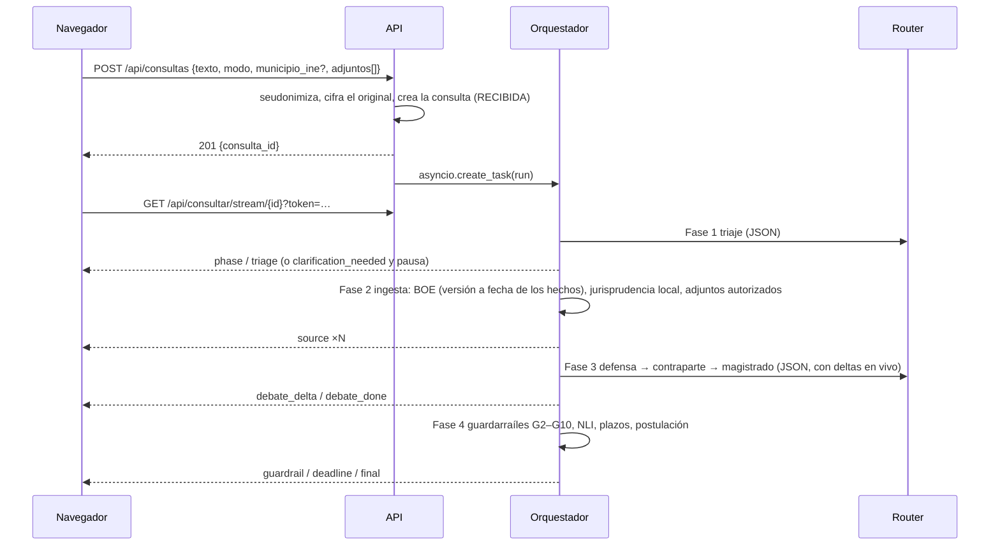

# Arquitectura

## 1. Visión general

```mermaid
flowchart LR
  subgraph Navegador["Navegador (PWA, http://127.0.0.1:8000)"]
    UI[React + Tailwind] -- REST + X-Iuris-Token --> API
    UI -- EventSource ?token= --> SSE
  end
  subgraph Backend["Backend local (FastAPI, solo 127.0.0.1)"]
    API[api/main.py] --> ORQ[core/orchestrator.py]
    SSE[/api/consultar/stream/] --- BUS[core/state.py EventBus]
    ORQ --> BUS
    ORQ --> ROUTER[core/router.py]
    ROUTER --> REG[core/providers/registry.py]
    REG --> GAPI[Gemini API]
    REG --> CLI1[claude -p]
    REG --> CLI2[agy (Antigravity)]
    REG --> CLI3[codex exec (desactivado)]
    ORQ --> BOE[connectors/boe_client.py] --> BOEAPI[(API BOE)]
    ORQ --> RET[connectors/retriever.py] --> DB[(SQLite WAL + FTS5)]
    RET --> LDB[(LanceDB)]
    ORQ --> CAL[core/calendar_engine.py]
    ORQ --> VAL[core/validators.py + nli.py]
  end
```

Principios que guían todo el diseño (dossier v3):
1. **Determinismo donde importa**: el LLM nunca calcula fechas, no elige normas (vienen del catálogo), no puede
   citar nada que no esté en el dossier y toda cita se verifica literalmente.
2. **Proveedores intercambiables**: ningún módulo del pipeline sabe qué modelo responde; todo pasa por el router.
3. **Local y privado**: servidor solo en loopback, token local, datos cifrados con DPAPI, seudonimización antes de
   enviar texto a un modelo externo.
4. **Degradación, no caída**: si un modelo falla o se queda sin cuota se usa el siguiente de su cadena.

## 2. Flujo de una consulta (4 fases)



### Fase 1 — Triaje (`Orchestrator._triaje`)
- Entrada: texto seudonimizado + aclaraciones + adjuntos autorizados.
- Prompt `core/prompts/triaje.md` con el **catálogo cerrado** de submaterias (`config/catalogo_materias.yaml`).
- El LLM devuelve un JSON tolerante (`TriageLLM`); el código construye `TriageOutputSchema` de forma determinista:
  normas BOE y plazos salen del catálogo, el municipio se resuelve contra el INE.
- Si faltan datos (fecha de inicio del plazo, municipio, ambigüedad ≥ 0,35) → `ESPERANDO_ACLARACION` y evento
  `clarification_needed`. **Una sola ronda**: tras responder, lo que falte se convierte en aviso.
- Submateria penal o no identificada → `FUERA_DE_ALCANCE`.

### Fase 2 — Ingesta (`_ingesta`)
- Para cada norma/artículo del catálogo: `BOERepository.get_articulo` (caché SQLite 7 días) y
  `temporal_sync.select_version` → **redacción vigente en la fecha de los hechos** + aviso si se reformó después.
- Jurisprudencia: `HybridRetriever.search` (FTS5/BM25 + vectores LanceDB, fusión RRF) sobre el corpus local.
  Sin resultados → cobertura degradada y la consulta se encola para ampliar el corpus.
- Adjuntos: solo los subidos con consentimiento (`permitir_envio`).
- Cada fragmento lleva un `source_id` estable: `BOE:<id_norma>:<id_bloque>:<vigencia>`, `ROJ:<roj>`, `DOC:<id>`.

### Fase 3 — Juicio contradictorio (`_debate`)
- Defensa → Contraparte (recibe las cuestiones de la Defensa) → Magistrado (recibe ambos alegatos).
- Todas devuelven JSON validado con Pydantic (`AlegatoSchema`, `ResolucionMagistradoSchema`); si no es válido,
  1 reintento con el error como feedback (`_llm_json`).
- **Lógica disyuntiva estricta**: cada cuestión se estima para DEFENSA o CONTRAPARTE; solo las de tipo `cuantia`
  admiten importe y deben anclarlo en una cita.
- Llamadas con `restartable=True`: si un modelo se corta a mitad, el router repite en el siguiente modelo.

### Fase 4 — Guardarraíles (`_guardarrailes`)
| Id | Qué comprueba | Dónde |
|---|---|---|
| G1 | Esquema JSON | Pydantic |
| G2 | La cita apunta a una fuente del dossier | `_verificar_citas` |
| G3 | Cita literal ≥ 95 % (RapidFuzz sobre texto normalizado, ≥ 40 caracteres) | `validators.verify_quote` |
| G4 | Sin pronósticos porcentuales ("70 % de ganar") | `validators.find_pronosticos` |
| G5 | La afirmación se deduce de la cita (NLI, otro canal) | `core/nli.py` |
| G6 | Banda de solidez coherente con la evidencia (nunca sube) | `validators.coherent_band` |
| G7 | Versión temporal de la norma | `temporal_sync` |
| G8 | Plazos calculados por el motor (no por el LLM) | `calendar_engine` |
| G9 | Postulación (abogado/procurador) | `postulacion_rules` |
| G10 | Materia con doctrina cambiante → banda máxima "disparidad" | catálogo |

Si fallan G2–G4: **1 reintento** del Magistrado con el informe de errores; después se descartan las citas
fallidas. Si no queda ningún fundamento verificado → `BLOQUEADA` (se siguen mostrando plazos y postulación).

### Máquina de estados (`core/state.py`)
```
RECIBIDA → TRIAJE → (ESPERANDO_ACLARACION → TRIAJE) | FUERA_DE_ALCANCE | INGESTA
INGESTA → (INGESTA_DEGRADADA) → DEBATE → GUARDARRAILES → (DEBATE: reintento) → CERTIFICADA | BLOQUEADA
cualquier estado → ERROR
```
Las transiciones inválidas lanzan `TransicionInvalida`. Al arrancar, `recover_interrupted()` pasa a `ERROR` las
consultas que quedaron a medias (excepto las que esperan aclaración).

## 3. Router de modelos (`core/router.py`)
- Resuelve `(modo, rol)` → alias (`config/profiles.toml` + `config/user_profiles.toml`).
- Recorre el alias y su cadena de `fallbacks` (BFS, sin repetir; puede cruzar proveedores).
- Salta un candidato si su proveedor no está en el registro (desactivado) o su **circuit breaker** está abierto.
- Errores *degradables* (cuota, rate limit, timeout, sin sesión, modelo no disponible) → siguiente candidato.
  `UsageLimitReached` abre el breaker del proveedor (persistido en SQLite).
- Ajusta el *effort* si el modelo no lo soporta (p. ej. Antigravity Gemini: solo low/medium).
- Registra cada llamada (ok o error, tokens, latencia) en `llm_calls_ledger`.

## 4. Proveedores (`core/providers/`)
Ver [proveedores_y_modelos.md](proveedores_y_modelos.md). Resumen:
- `GeminiApiAdapter` envuelve `core/gemini_client.py` (streaming, token bucket RPM, límite RPD, detección de cuota
  diaria agotada con la hora de reinicio, timeout).
- `CliAdapter` es genérico para cualquier CLI con modo no interactivo: **un hilo + cola + FileLock por proveedor**
  (nunca dos procesos del mismo CLI a la vez), prompt por stdin (sin límite de argv), cwd en un directorio vacío,
  timeout duro, parser de salida configurable.

## 5. Persistencia
- **SQLite** (`data/local/local_cache.db`, WAL): consultas (texto original y mapa de seudónimos cifrados con DPAPI),
  eventos SSE (replay), caché BOE, sentencias, convenios, festivos, ledger de llamadas, estado de breakers.
  Migraciones en `storage/migrations/NNNN_*.sql`, aplicadas en orden al arrancar.
- **LanceDB** (`data/local/lancedb_store/`): trozos de fundamentos y fallos con embeddings de 768 dimensiones.
- **Log** de diagnóstico: `data/local/logs/iuris.log`.
- Detalle del esquema: [datos_y_fuentes.md](datos_y_fuentes.md#esquema-de-la-base-de-datos).

## 6. Frontend (`web/`)
- React 18 + TypeScript + Tailwind; PWA con `vite-plugin-pwa`.
- `lib/api.ts`: token desde `/api/token`, reintento tras 403, errores `ApiError` con código y ruta.
- `lib/useConsulta.ts`: reducer de la consulta; `EventSource` con reanudación por número de evento (`after`) y
  reapertura con token nuevo si el stream se rechaza; los deltas se agrupan por frame (`deltaBuffer.ts`).
- `lib/selfHeal.ts`: si el bundle no coincide con `/api/version`, desregistra el service worker, limpia cachés y
  recarga una vez.
- Service worker: precachea solo `js/css/svg/webmanifest`; **nunca HTML ni API**.
- Componentes (diseño en [propuesta_rediseno.md](propuesta_rediseno.md)): `TopBar` (menú de modo y acceso a
  Ajustes), `Sidebar` (historial por fechas, plegable), `Composer` (centrado al inicio y fijo abajo después; municipio
  y adjuntos con consentimiento), `Results` (progreso, aclaraciones, respuesta con fundamentos numerados, plazos,
  postulación y el proceso plegado: triaje, fuentes y debate), `SourceViewer` (panel derecho con el texto oficial y
  la cita resaltada), `settings/*` (Modos, Cuentas y planes, Modelos personalizados, Apariencia) y `ui/primitives`.
- Estilo: tokens de color en `src/index.css` (claro y oscuro), expuestos a Tailwind en `tailwind.config.js`; fuentes
  Inter y Source Serif 4 autoalojadas (`@fontsource`), sin CDN.

## 7. Seguridad y privacidad
| Medida | Implementación |
|---|---|
| Solo local | uvicorn en `127.0.0.1`; `TrustedHostMiddleware` (127.0.0.1/localhost) contra DNS rebinding |
| Token local | `data/local/local_token.txt`; obligatorio en operaciones de escritura (`X-Iuris-Token`) y en el SSE (`?token=`); `/api/token` sin CORS |
| Datos en reposo | Texto original, mapa de seudónimos y adjuntos cifrados con DPAPI (usuario de Windows) |
| Datos a modelos | Seudonimización (DNI/NIE con letra válida, IBAN, teléfonos, emails, matrículas, nombres tras fórmulas); adjuntos solo con consentimiento |
| CLIs | cwd vacío, sin herramientas (`--tools ""` en Claude), flags `--dangerously-*` rechazados por la configuración |
| Deontología | Sin porcentajes de éxito (G4, art. 403 CP); banner de postulación; aviso legal fijo |
